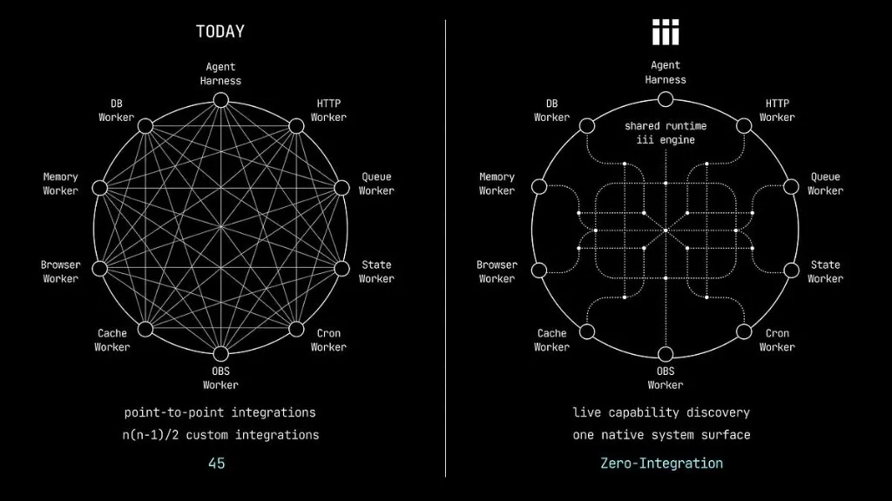

<h1 align="center">iii</h1>

> 本文件是 [README.md](README.md) 的简体中文翻译。为方便同步，正文中的代码、命令、专有名词（Worker、Trigger、Function、Compose、SDK 等）保持原文。



<p align="center">
<a href="https://trendshift.io/repositories/22583?utm_source=repository-badge&amp;utm_medium=badge&amp;utm_campaign=badge-repository-22583" target="_blank" rel="noopener noreferrer"></a>
</p>


<!-- Release -->
<p align="center">
  <a href="https://hub.docker.com/r/iiidev/iii"></a>
  <a href="https://www.npmjs.com/package/iii-sdk"></a>
  <a href="https://pypi.org/project/iii-sdk/"></a>
  <a href="https://crates.io/crates/iii-sdk"></a>
  <a href="https://discord.gg/iiidev"></a>
</p>

<!-- Downloads -->
<p align="center">
  <a href="https://workers.iii.dev/"></a>
  <a href="https://workers.iii.dev/"></a>
  <a href="https://hub.docker.com/r/iiidev/iii"></a>
  <a href="https://www.npmjs.com/package/iii-sdk"></a>
  <a href="https://pepy.tech/projects/iii-sdk"></a>
  <a href="https://crates.io/crates/iii-sdk"></a>
</p>

<!-- Index -->
<p align="center">
  <a href="#什么是-iii">什么是 iii？</a> ·
  <a href="#安装-iii">安装 iii</a> ·
  <a href="#添加-worker">添加 Worker</a> ·
  <a href="#sdk">SDK</a> ·
  <a href="#面向第三方-harness-的-agent-skills">Agent Skills</a> ·
  <a href="#控制台-console">Console</a> ·
  <a href="#资源">资源</a>
</p>

## 什么是 iii？

iii 是在实时场景中组合（compose）、观测（observe）、发现（discover）、扩展（extend）并响应（react）你技术栈中每一个服务的最简单方式，即 **CODER**。

每一个后端在写下第一行业务逻辑之前，都始于一个项目。队列、定时任务（cron）、HTTP、状态管理、可观测性、agent、沙箱（sandbox），往往各自都带来一套需要单独打通的集成方案，让 CODER 变得复杂。iii 用一个实时的系统界面（live system surface）统一解决了所有这些关注点。

```bash
iii compose --namespace dev --up
iii trigger -n dev compose::add worker=queue
iii trigger -n dev compose::add worker=agent
iii trigger -n dev compose::add worker=<anything>
```

每个 Worker 都会加入实时目录（live catalog）。其他所有 Worker 会立即收到通知并可以直接调用它。可在 [workers.iii.dev](https://workers.iii.dev/) 浏览可用的 Worker。

这也是关于 agent 的故事：当某个任务需要系统尚不具备的能力时，agent 可以添加一个 Worker、发现它的函数、调用它们，并追踪发生了什么。开发者与 agent 使用的是同一套接口。

### 三大原语

iii 由 3 个原语驱动：

**Workers** 是向 iii 引擎注册、随后再注册 Triggers 和 Functions 的进程。一个 TypeScript API 服务是一个 Worker，一个 Python 数据管道是一个 Worker，一个 Rust 微服务也是一个 Worker。只需几行代码，任何功能都可以被改造为一个 Worker。Compose 还能在运行时添加 Worker，因此 agent 和应用可以在系统运行的过程中对其扩展。

**Triggers** 是任何会触发某个函数运行的东西。Trigger 可以是对函数的直接调用、一个 HTTP 端点、一个 cron 计划、一个队列订阅、一次状态变更、一个流事件，或其他任何事物。Triggers 是声明式的：Worker 声明“当某件事发生时运行这个函数”，而 iii 负责路由、序列化和投递。

**Functions** 是具有稳定标识符的工作单元（例如 `content::classify`、`orders::validate`）。它接收输入、执行工作，并可选择性地返回输出。Functions 存在于 Worker 之中。

通过将服务所能做的一切映射到这三个原语，iii 打造出一个既毫不费力地可组合、又完全可观测的开发流程。

## 带来什么改变

在使用 iii 之前：

- 新的可观测性工具：数不尽的集成工作
- 新的 agent harness：单独的重试配置、单独的链路追踪、单独的超时
- 新的队列：厂商评估、采购，以及数周的集成

在使用 iii 之后：

- 在 `worker-compose.yaml` 中声明 Worker
- 用 `iii compose --up` 运行它们
- 完成。它已进入系统，可被追踪、可被调用。

平台团队发布 Worker，应用团队注册函数、声明 Trigger，agent 使用同一份目录、同一套函数调用。

扩展 iii 就是添加一个 Compose Worker；编排 iii 就是调用函数；观测 iii 就是打开那条链路追踪（trace）。

## 安装 iii

安装 `iii`：

```bash
curl -fsSL https://install.iii.dev/iii/main/install.sh | sh
```

## 添加 Worker

在 `worker-compose.yaml` 中声明项目的 Worker，或通过一个正在运行的 Compose 守护进程添加它们：

```bash
iii trigger -n dev compose::add worker=queue
```

在 [workers.iii.dev](https://workers.iii.dev/) 浏览软件包，并查阅
[Compose 文档](https://iii.dev/docs/using-iii/compose)。

## SDK

| 语言 | 软件包 | 安装 |
| -------- | -------------------------------------------------- | ------------------------------------------- |
| Node.js  | [`iii-sdk`](https://www.npmjs.com/package/iii-sdk) | `pnpm add iii-sdk` 或 `npm install iii-sdk` |
| Python   | [`iii-sdk`](https://pypi.org/project/iii-sdk/)     | `pip install iii-sdk`                       |
| Rust     | [`iii-sdk`](https://crates.io/crates/iii-sdk)      | 添加到 `Cargo.toml`                         |
| Go       | [`iii-sdk`](sdk/packages/go/iii)                       | `go get github.com/iii-hq/iii/sdk/packages/go/iii` |

## 面向第三方 harness 的 Agent Skills

如果你使用的是 iii harness，那么 agent skills 会自动可用。

如果你使用的是其他 harness，可以通过以下方式安装 iii 的 skills：

```bash
npx skills add iii-hq/iii/skills
```

这些 skills 覆盖了 iii 的每一个原语：HTTP 端点、队列、cron、状态、流、自定义 Trigger 等等。完整列表见 [skills/](skills/)。

[iii-hq/workers](https://github.com/iii-hq/workers) 中的每个 Worker 也自带各自的 skill。可与 Worker 一起安装：

```bash
npx skills add iii-hq/workers --list        # 列出可用的 worker skills
npx skills add iii-hq/workers --skill database # 单个 worker
npx skills add iii-hq/workers --all         # 所有 worker skill
```

引擎自带的 Worker（`configuration`、`iii-worker-manager`、`iii-http-functions`、`iii-stream` 和 `iii-sandbox`），以及由引擎自动提供的函数、遥测与可观测性 Worker，都在本仓库中。HTTP、cron、队列、状态、pubsub 和 bridge 则是独立的 Compose Worker。使用 `npx skills add iii-hq/iii --full-depth --skill <name>` 安装某个引擎 skill；独立 Worker 会在 [iii-hq/workers](https://github.com/iii-hq/workers) 中随自身分发各自的 skills。

## 控制台 (Console)

[iii-console](console/) 是面向开发者与运维的控制台，用于检查 Worker、函数、Trigger、队列、链路追踪、日志以及实时状态。安装与用法见
[Console 文档](https://iii.dev/docs/using-iii/console)。

## 仓库结构

| 目录 | 说明 | README |
| ---------- | ------------------------------------------------------- | -------------------------------------- |
| `engine/`  | iii 引擎（Rust）——核心运行时、模块与协议 | [engine/README.md](engine/README.md)   |
| `sdk/`     | 面向 Node.js、Python、Rust 与 Go 的 SDK                  | [sdk/README.md](sdk/README.md)         |
| `console/` | 开发者控制台（React + Rust）                        | [console/README.md](console/README.md) |
| `skills/`  | 供 agent 阅读的参考材料                       | [skills/README.md](skills/README.md)   |
| `website/` | iii 官网                                             | [website/](website/)                   |
| `docs/`    | 文档站点（Mintlify/MDX）                       | [docs/README.md](docs/README.md)       |

工作区依赖关系见 [CONTRIBUTING.md](CONTRIBUTING.md#how-dependencies-work)，持续集成与发布流程见 [CI/CD](CONTRIBUTING.md#cicd)。

## 资源

- [文档](https://iii.dev/docs)
- [CLI 与引擎](https://github.com/iii-hq/iii)
- [Console](console/)
- [示例](https://github.com/iii-hq/iii-examples)
- [贡献指南](CONTRIBUTING.md)

## Star 趋势

<p align="center">
  <a href="https://www.star-history.com/?repos=iii-hq%2Fiii&type=date&legend=top-left">
    <picture>
      <source media="(prefers-color-scheme: dark)" srcset="https://api.star-history.com/chart?repos=iii-hq/iii&type=date&theme=dark&legend=bottom-right" />
      <source media="(prefers-color-scheme: light)" srcset="https://api.star-history.com/chart?repos=iii-hq/iii&type=date&legend=bottom-right" />
      
    </picture>
  </a>
</p>

## 许可证

iii 按如下方式授权：

| 目录 | 许可证 |
| ---------- | ------------------------------------- |
| `engine/`  | [Elastic License 2.0](engine/LICENSE) |
| `sdk/`     | [Apache License 2.0](sdk/LICENSE)     |
| `console/` | [Apache License 2.0](console/LICENSE) |
| `docs/`    | [Apache License 2.0](docs/LICENSE)    |
| `website/` | [Apache License 2.0](docs/LICENSE) |

引擎运行时和 CLI 采用 Elastic License 2.0（ELv2）授权。所有 SDK、console、文档以及官网均采用 Apache License 2.0 授权。

更多细节见 [CONTRIBUTING.md](CONTRIBUTING.md)。
