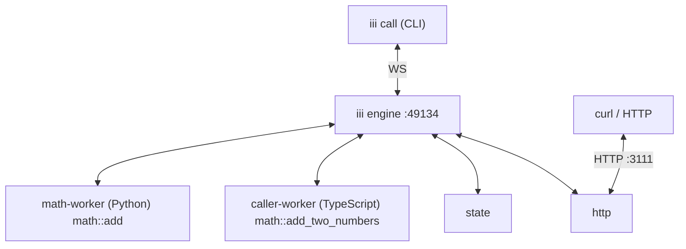

Unix gave processes a single interface. React gave components a single interface. iii gives every
category of software (queues, schedulers, agents, frontends, sandboxes, business logic, etc.) a
single interface: **Workers** host work, **Functions** are the work, **Observers** run one Function
when another Function runs, and the **Engine** routes between them. Once you have a mental model for
those four pieces, everything else in iii is a variation on a theme.

<Note>This page uses the [Quickstart tutorial](../quickstart) as an example.</Note>

## The four pieces

This is a brief recap of the four pieces; the sections below expand each one with the Quickstart as
an example. More details about their actual usage are in [Using iii / Workers](../using-iii/workers)
and the rest of the "Using iii" section.

### Worker

A Worker is anything that connects to the Engine and registers Functions with it. Workers can run
anywhere (on a laptop, in a container, in a browser tab, on a microVM) and in any language as long
as they can open a WebSocket to the Engine.

### Function

A Function is a named handler inside a Worker. It takes a payload and returns a result. Function
identifiers follow a `service::name` convention so they remain stable across worker restarts and
language boundaries. Any Worker runs a Function with `worker.call()`.

### Observer

An Observer connects two Functions, an observed Function and a target: when the observed Function
runs, the target runs.

```typescript
worker.observe("orders::create", "alerts::big-order");
```

When `orders::create` runs, `alerts::big-order` runs. By default, each successful call of the
observed Function runs the target.

### Engine

The Engine is the coordinator. It accepts worker connections, maintains a live registry of available
Functions and Observers, and routes invocations to whichever Worker currently provides the requested
Function.

## The Quickstart

The Quickstart tutorial produces a running system with two Workers connected to the same Engine:

1. `math-worker` is a Python Worker that registers `math::add`.
1. `caller-worker` is a TypeScript Worker that registers `math::add_two_numbers`, which calls
   `math::add` through the Engine.

By the end of the Quickstart, the system also includes the `state` and `http` Workers, an HTTP route
at `POST /math/add-two-numbers` that calls `math::add_two_numbers`, and a key-value scope named
`math` holding a `running_total`.

The runtime topology looks like this:



Every arrow is a WebSocket connection between a Worker and the Engine. There is no direct
worker-to-worker traffic. When `caller-worker` invokes `math::add`, the call goes through the
Engine, which looks up the current location of `math::add` in its registry and routes the invocation
to `math-worker`.

## Workers

Workers do the work in an iii system. Every category of capability is built as a Worker: queues,
scheduling, sandboxing, observability, agents, business logic, devices, and even code executing in a
browser.

Specifically, a Worker is a process that connects to the Engine over WebSocket and announces a set
of Functions it can run. Once connected, those Functions are invocable from anywhere in the system
without per-pair integration code between the caller and the Worker. A Worker can also observe
Functions, so that its own Functions run when other Functions run.

The Worker concept is intentionally narrow. A Worker is not a microservice, a job runner, or a
sidecar. It is a participant in the Engine's live registry that contributes Functions and Observers.
Whether the Worker is a long-lived process serving thousands of invocations per second or a
short-lived process that connects, registers, runs once, and shuts down, the Engine treats it the
same.

### Worker isolation

Workers are intended and designed to be independent processes. One Worker crashing does not affect
others. The Engine connects to each Worker over a separate WebSocket and routes invocations only to
Workers that are currently connected. A crash, restart, or network partition affecting one Worker
does not propagate to the others. The crashed Worker's Functions drop out of the routing table on
disconnect, and every other Worker keeps serving. Its Observers wait as `suspended`. If the Worker
does not connect again in time, the Engine removes them.

### In the Quickstart

Both Workers in the Quickstart fulfill the same contract: open a WebSocket connection to the Engine.
Once connected they can register Functions, call other Functions with `call()`, and observe
Functions. A Worker will typically do at least one of these things but ultimately isn't required to
do any of them.

The Python and TypeScript Workers are independent processes in different languages, with different
runtimes, possibly on different machines. Neither one knows the execution context of the other. They
both talk to the Engine, and the Engine handles the rest.

This is what "any language, any runtime" means in practice: the worker contract is small enough to
implement in any language that can use a WebSocket and JSON, and the Engine treats every Worker the
same regardless of how it was built or where it runs.

<Note>
  For the connection lifecycle from worker code, see [Creating Workers /
  Workers](../creating-workers/workers#worker-lifecycle).
</Note>

## Functions

A Function is a named handler inside a Worker. It takes a payload and returns a result. From the iii
system's perspective, a Function is identified by its name and addressable across language and
location boundaries. Callers do not know what Worker is providing the Function, what language the
handler is written in, or where the Worker is running. The Engine routes each invocation to a Worker
that currently provides the target Function.

A Function has no fixed shape beyond payload-in / result-out. Some Functions are pure computation.
Some perform side effects (state writes, HTTP calls, queue enqueues). Some are agentic, invoking
other Functions in turn. The Engine does not distinguish: routing is the same for all of them.

### Function identifiers

Function identifiers use the `service::name` convention. The `service` segment groups related
Functions together as a namespace, scope, or worker name. The `name` segment is the specific
handler. Identifiers like `math::add`, `state::get`, and `http::on-request` follow this convention.

The convention is a recommendation, not a hard rule. Any string is a valid function ID at the engine
level, but the `service::name` form makes the Function's intent obvious to readers and avoids
collisions between unrelated Functions registered by different Workers.

{/* TODO: Confirm if we still have restricted string prefixes */}

### Calling a Function

Registering a Function with `registerFunction()` makes it callable through `worker.call()` from any
connected Worker and through the `iii call` CLI command. The Engine looks up the `function_id` in
its live registry, finds a Worker that currently provides the Function, and sends the invocation to
it. The handler sees the payload alone. It does not see where the call came from.

### Call actions

By default, a call waits until the Function returns its result or the timeout expires. Use this when
the caller needs the value that the Function returns. With `CallAction.Void()`, the call returns at
once and does not wait for a result. Use it for side effects that the caller does not need to wait
for.

<Note>
  Workers can also define their own call actions. The queue Worker provides `CallAction.Enqueue`,
  which routes the invocation through a named queue with retries.
</Note>

### In the Quickstart

The Quickstart calls Functions in three ways:

1. The CLI command `iii call math::add a=2 b=3` calls `math::add`. The Engine routes the invocation
   to `math-worker`, the Worker that provides `math::add`.
1. `math::add_two_numbers` calls `math::add` with `worker.call({ function_id: 'math::add', ... })`.
   The Engine routes this call in the same way as the CLI call.
1. The `http` Worker owns the HTTP socket. Each request it receives is a call of its Function
   `http::on-request`. `caller-worker` observes `http::on-request` for `POST /math/add-two-numbers`,
   so a request to that route runs `http::add_two_numbers`, which calls `math::add_two_numbers`. The
   value `http::add_two_numbers` returns is the HTTP response. `math::add_two_numbers` and
   `math::add` see a payload, like every other call.

Function IDs are stable across worker restarts. When `math-worker` stops and restarts, callers do
not need to know: they keep invoking `math::add`, and the Engine routes the calls to whichever
instance currently provides that Function.

## Observers

An Observer runs a target Function each time an observed Function runs:

```typescript
worker.observe("math::add", "audit::record");
```

When `math::add` runs, `audit::record` runs. Any Worker can observe any Function, unless RBAC or the
Function itself restricts it.

This is how everything in iii is reactive. A Worker that produces events exposes each kind of event
as a Function and calls it when the event happens: each HTTP request is a call of
`http::on-request`, each cron tick a call of `cron::on-tick`, each queue message a call of
`queue::on-message`, each state write a call of `state::on-changed`, and each row change a call of
`database::on-row-changed`. Reacting to any of them is the same `observe`.

### What an Observer sees

An Observer observes the calls of its observed Function: the input, the output (the value the
handler returns), and the caller. By default, each successful call runs the target, and the target
receives an envelope with the call's input, output, and caller. With `on`, an Observer can also get
the failed calls of the observed Function, or all its calls.

### Args and filters

Some Functions take `args` from each Observer. The route of an `http::on-request` Observer and the
schedule of a `cron::on-tick` Observer are `args`:

```typescript
worker.observe(
  { function_id: "cron::on-tick", args: { expression: "0 0 9 * * * *" } },
  "reports::daily-summary",
);
```

`args` are for the Function's Worker: the cron Worker reads `expression` and runs that schedule. The
documentation of each Function lists the `args` it takes. `filters` are for iii: they select which
calls run the target, by the call's input, output, error, caller, and metadata, for example only
orders with a total of 500 or more.

### Defaults a Worker can override

By default iii accepts every Observer and runs the target of each one whose filters match. The
Worker that hosts a Function can override these defaults, for example to start the cron job an
Observer's `expression` asks for, or to give each HTTP request to the Observer of its route; see
[Observable functions](../creating-workers/observable-functions). The http, cron, queue, and
database Workers use this to set up a route, schedule, consumer, or capture for each Observer.

The Engine and the observability Worker also host Functions for their own events, such as
`engine::on-functions-changed`, `engine::on-workers-changed`, `engine::on-observers-changed`,
`configuration::on-updated`, and `observability::on-log`.

### Observer lifecycle

An Observer is `pending` until its observed Function and target are registered and the Worker that
hosts the observed Function has accepted it, and then it is `active`. When the observing Worker
disconnects, its Observers become `suspended`. If the Worker connects again within
`observers.observer_grace_ms` (30 s by default), it keeps its Observers. If not, they become
`disposed`. When the Worker that hosts the observed Function disconnects, its Observers wait as
`pending` until a Worker registers it again. An Observer that the Engine or the hosting Worker
rejects is `error`.

### Chains and the loop guard

A call of a target is a normal call, so another Observer can observe it. Each step adds 1 to the
depth of the chain. When the depth is more than `observers.max_observe_depth` (8 by default), the
Engine does not run the next target. This stops Observer loops.

### In the Quickstart

The Quickstart's HTTP route is an Observer. `caller-worker` observes `http::on-request` and gives
the route as `args`:

```typescript
worker.observe(
  {
    function_id: "http::on-request",
    args: { method: "POST", path: "/math/add-two-numbers" },
  },
  "http::add_two_numbers",
);
```

The http Worker reads the route from `args`. When a `POST /math/add-two-numbers` request arrives, it
calls `http::on-request`, and the Observer runs `http::add_two_numbers` with the request.

Any Worker can add more Observers to the same system. This one runs `audit::record` after each
successful call of `math::add`:

```typescript
worker.observe("math::add", "audit::record");
```

For the full model, see [Observers](../using-iii/observers). To make your own Functions take `args`
and override the defaults, see [Observable functions](../creating-workers/observable-functions) in
Creating Workers.

## The Engine

The Engine is a single process that holds the registry of every connected Worker, every registered
Function, and every Observer. When a Worker connects, the Engine records what Functions it provides.
When a Worker disconnects, the Engine removes its Functions, cancels any in-flight invocations of
those Functions, and notifies the rest of the system that the topology changed.

Routing is independent of language, runtime, and location. The Engine does not need to know where
`math::add` is running in Docker, on a Raspberry Pi, or in a browser tab. It knows that _some_
Worker provides it. The same tutorial can be redeployed across different runtimes without touching
the function code.

<Note>
  See [Engine](./engine) for startup flow, config hot-reload, and the live registry and discovery
  surface.
</Note>
