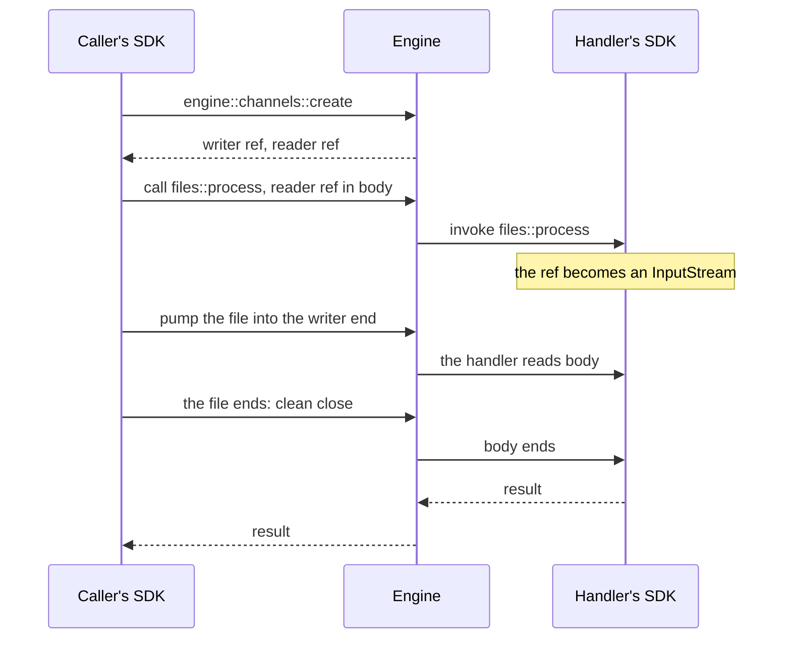

## What a stream is

A stream is a value of a call. A field of a payload, or of a result, can hold a file, a readable, a
generator, or a place to write to. The function on the other side receives an `InputStream` to read,
or an `OutputStream` to write. The two functions can run in different processes and languages, and
the bytes flow while both run.

Streaming uses the same `call` as everything else. There is no setup step and no separate object to
pass around: the SDK finds the stream values in what it sends, and turns what it receives back into
streams.

<Note>
  This is the model of the TypeScript (Node), Python, and Rust SDKs from 0.27. The Go SDK and the
  browser SDK keep the channel API in 0.27, on the same wire. See [Old and new
  SDKs](#old-and-new-sdks).
</Note>

## The model

| Concept        | What it is                                                                                               |
| -------------- | -------------------------------------------------------------------------------------------------------- |
| `InputStream`  | The read side. A source in a payload or a result (a file, a readable, a generator) arrives as one.       |
| `OutputStream` | The write side. A sink in a payload or a result (a writable, a file to create) arrives as one.           |
| Pipe           | The engine-managed connection that carries one stream, from one writer to one reader.                    |
| Ref            | `{ channel_id, access_key, direction }`: the small JSON value that takes the stream's place in the call. |
| `StreamInfo`   | `{ stream: true, direction, id }`: what an observer receives where the observed call carried a stream.   |

The type name gives the direction, from the holder's side: you read an `InputStream` and write to an
`OutputStream`. It matches the `direction` the engine puts in each ref: a `read` ref becomes an
`InputStream`, a `write` ref becomes an `OutputStream`.

The engine's side keeps its own name. A pipe is created with `engine::channels::create` and carried
over `/ws/channels/<id>` sockets, so traces and the engine protocol show `channels`.

## Why streams exist

A call is a JSON message. That fits structured events and commands, and it does not fit a 100 MiB
file, a video, a model's tokens as they are generated, or the output of a job that runs for minutes.
A single message is capped at 64 MiB, it has to be complete before it is sent, and the receiver
holds all of it in memory.

Streams split coordination from data transfer:

- The call coordinates the work. Its payload carries a ref where the stream was.
- The pipe carries the bytes, with backpressure, while the call runs.
- The engine routes both, and traces them as part of the call.

## Runtime flow

A caller sends `report.csv` to `files::process`, and the handler reads it:

The caller's SDK finds the file in the payload, creates a pipe for it (one per stream, in parallel
when there are several), puts the reader ref where the file was, and pumps the file into the writer
end. The handler's SDK turns the ref back into an `InputStream` before the handler runs. A result
works the same way in the other direction: a source the handler returns reaches the caller as an
`InputStream` in its result.

A sink goes the other way through the same pipe. The caller's SDK sends the writer ref, the handler
writes to its `OutputStream`, and the caller's SDK copies what arrives into the sink. The call
resolves after the sink has received everything.

## Sources and sinks

The SDK streams only the values it recognizes. Plain objects, arrays, strings, and buffers stay
JSON.

| SDK        | Sources (arrive as `InputStream`)                                                                | Sinks (arrive as `OutputStream`)                      |
| ---------- | ------------------------------------------------------------------------------------------------ | ----------------------------------------------------- |
| TypeScript | `InputStream`, Node `Readable`, Web `ReadableStream`, `Blob` and `File`, async generator objects | `OutputStream`, Node `Writable`, Web `WritableStream` |
| Python     | `InputStream`, async generator objects, binary file objects opened for reading                   | `OutputStream`, built with `to_file()` or `to()`      |
| Rust       | `InputStream`, built with `from_reader`, `from_stream`, or `from_bytes`                          | `OutputStream`, built with `to_writer`                |

Anything else becomes a source with `InputStream.from(...)` (TypeScript), `InputStream.from_iter()`
or `InputStream.from_bytes()` (Python), and the Rust constructors. Rust has no detection: a payload
is a serde value, so the constructors mark what streams.

## Bytes and messages

A pipe carries two kinds of frames, in one order:

- **Bytes**, in binary frames. You write them with `write` and read them by iterating the stream.
- **Messages**, in text frames. You send a JSON value with `send` and read the values with
  `messages()`.

A stream can carry both. The HTTP worker relies on it: a route's `response` takes the status and the
headers as messages and the body as bytes. Byte iteration skips messages, `messages()` skips bytes,
and `frames()` yields both in the order they were sent.

## Lifecycle

The SDKs apply the same rules, so the common path needs no cleanup code:

- **A source is pumped by the SDK.** When it ends, the stream closes. When it fails, the stream
  aborts, and the reader gets an error instead of a short stream that looks complete.
- **A received `OutputStream` closes when the handler returns, and aborts when it throws.** A
  handler that keeps writing after it returns calls `keepOpen()` and then closes or aborts the
  stream itself. A stream the handler never touched is closed too when the handler returns, so a
  caller's sink always ends. The exception is a call that comes through an observer, such as an HTTP
  route: there, an untouched stream is closed only when the handler returns nothing, because the
  HTTP worker reads an untouched `response` with a result as a buffered response.
- **A received `InputStream` that the handler started reading and did not finish is cancelled when
  the handler returns.** The engine then closes the writer, as it does whenever a reader leaves. A
  stream the handler never read is left alone.
- **A call resolves after the sinks passed to it have finished.** If the stream into a sink aborts,
  the call fails with `STREAM_ABORTED`, even when the function succeeded. The call's timeout covers
  this wait: when it expires first, the SDK aborts the open sinks and the call fails with `TIMEOUT`.
  A call whose result hands a stream to write back to the caller does not wait for its sinks, since
  they may depend on what the caller writes next.
- **Forwarding an unread `InputStream` sends its ref.** No bytes pass through the forwarding worker.
  Once it has been read from, forwarding pumps the rest.
- **A stream has one reader.** Reading an `InputStream` a second time fails. In TypeScript and
  Python, `tee()` makes copies in the same process, before the first read.
- **Streams need a live call.** A call sent with `CallAction.Enqueue` and a stream in its payload is
  refused with `STREAM_NOT_ALLOWED`: the job can run after the pipe expired, and a retry cannot read
  the stream again. `CallAction.Void` is allowed.

Streams connect lazily. Creating a pipe allocates its refs, and each end opens its socket when it is
first read or written. `write` and `send` resolve when the chunk is accepted, so a loop of awaited
writes never buffers without bound, and a slow reader slows the writer instead.

### Abort

A clean close ends the stream: the reader receives everything that was written, and then the end.
Any other close aborts it. The engine relays an abort to the reader as a close with code 1011 and
its own reason, such as `channel writer aborted: closed with code 1011`, and the reader's SDK
reports it as an error after the data that was already sent: `StreamAbortedError` in TypeScript and
Python, and `Error::StreamAborted` in Rust, all with the code `STREAM_ABORTED`. The engine does not
relay the writer's reason, so the cause of a failure travels in the call's error or result.

A writer aborts on purpose with `abort(reason)`, which is one call in every SDK. If its socket never
opened, `abort` opens it first, so the reader always learns of the failure. A crash or a lost
connection aborts on its own. A writer left open, in any SDK, keeps its reader waiting until its
socket goes away; the handler rules above close the streams a handler received.

### Pipe ownership

A pipe belongs to the worker that created it: the worker whose SDK found a source or a sink in what
it sent, or the worker that called `iii.pipe()`. When that worker disconnects, the engine releases
the pipe:

- Ends that no worker has attached yet are dropped. A later attempt to attach with that ref fails
  with HTTP `404`.
- A reader already waiting for a writer that never attached gets an error, not the end of the
  stream.
- Streams with both ends already attached keep running until they complete.

The owner must stay connected until the other side has attached to its end. Forwarding a stream does
not change its owner. An end that nobody attaches is dropped after about five minutes.

### Releasing a pipe

The engine releases a pipe as soon as either side leaves:

- When the reader finishes or disconnects, the engine removes the pipe. An end that was never
  attached goes with it.
- When the reader is gone, the engine closes an attached writer right away, even if the writer is
  idle, instead of waiting for its next write.

A pipe carries one direction. For a two-way exchange, pass two streams: an `InputStream` for what
the function reads and an `OutputStream` for what it writes.

## Streams and observers

A stream can be read once, and the first socket to attach takes its end. An observer that captured
the live input of a call could take the bytes before the observed function read them. So when an
observer captures the `input` or `output` of a call that carried a stream, the target receives a
`StreamInfo` in that field instead of a live end: `{ stream: true, direction, id }`, where `id` is
the pipe's id. Other fields arrive as usual, and filters keep working.

The target's SDK applies this rule to the `Observed` payload the engine builds. A call that a worker
makes through an observer, such as the HTTP worker's call of a route with its `request_body` and
`response`, is not an observed call: its target receives live streams.

<Warning>
  The ref, with its access key, is still in the observed payload on the wire. A target on the Go or
  browser SDK, or on an SDK before 0.27, receives that ref as it does today, and opening it races
  the observed function for the stream.
</Warning>

## Old and new SDKs

The wire is unchanged: a 0.26 engine serves 0.27 SDKs, and the ref JSON is the same for every SDK.
Workers on old and new SDKs work together in one project:

- A ref that a 0.26 SDK, the Go SDK, or the browser SDK sends arrives in a 0.27 handler as an
  `InputStream` or an `OutputStream`, and in a 0.27 call result the same way.
- A stream that a 0.27 SDK sends arrives as a `ChannelReader` or a `ChannelWriter` in a handler on a
  0.26 TypeScript or Python SDK or on the browser SDK, and as the ref JSON in Go and in 0.26 Rust.

The Go SDK (`client.CreateChannel`, `client.OpenReader`, `client.OpenWriter`) and the browser SDK
(`createChannel`) keep the channel API in 0.27. For the code, see
[Streaming](../creating-workers/streaming). For the move from the channel API, see
[Upgrading from 0.26.x](../upgrading/from-0-26-x).
