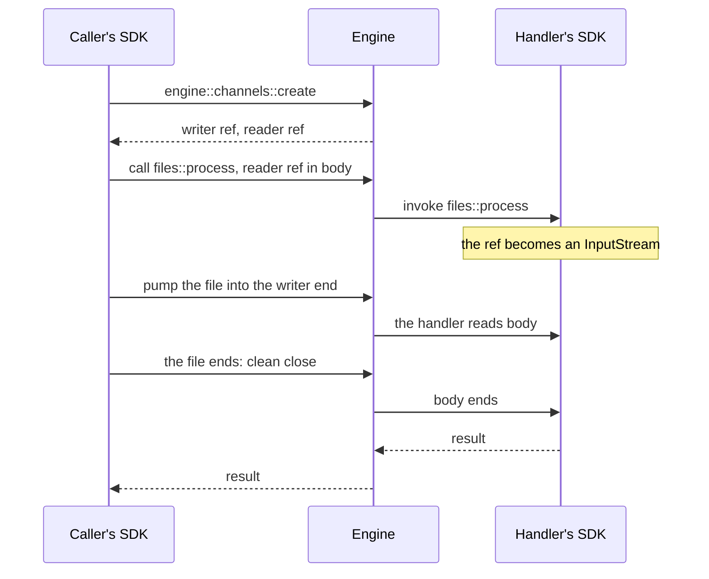

<!-- generated by iii-skill-render. DO NOT EDIT (changes here are overwritten on the next render). Edit docs/next/understanding-iii/streaming.mdx. -->

# Streaming

## How a stream works

A typical call is one JSON message. A message has a size limit, the sender must have all of the
required data before it starts sending, and both the sender and the receiver must keep all of it in
memory.

Streams are different because they don't have size limits, don't need all of the data they're
sending ahead of time, and neither the sender nor the receiver need to keep the full payload in
memory. Instead when you create a stream the call will send a reference to the receiver and the
receiver can use that reference to access the stream.

| Term           | Meaning                                                                                      |
| -------------- | -------------------------------------------------------------------------------------------- |
| `InputStream`  | The end you read. A source in a payload or a result arrives as an `InputStream`.             |
| `OutputStream` | The end you write. A sink in a payload or a result arrives as an `OutputStream`.             |
| Pipe           | The connection in the engine that carries one stream from one writer to one reader.          |
| Ref            | `{ channel_id, access_key, direction }`, the JSON value that replaces a stream in the call.  |
| `StreamInfo`   | `{ stream: true, direction, id }`, the value an observer receives in place of a live stream. |

A `read` ref becomes an `InputStream`, and a `write` ref becomes an `OutputStream`. A pipe carries
data in one direction. For a two-way exchange, use two streams.

This is the flow when a caller sends `report.csv` to `files::process`:

A source uses the pipe like this:

1. The caller's SDK finds the file in the payload and creates a pipe for it.
2. The SDK puts the reader ref in place of the file, sends the call with the reader ref.
3. The handler's SDK turns the ref into an `InputStream` and reads from the pipe.

A sink uses the pipe in the other direction:

1. The caller's SDK finds the sink in the payload and creates a pipe for it.
2. The SDK puts the writer ref in place of the sink, sends the call with the writer ref.
3. The handler's SDK turns the ref into an `OutputStream` and writes to the pipe.

<Note>
  The engine internally calls a pipe a channel. They are the same thing. It creates a pipe with `engine::channels::create` and carries
  it over `/ws/channels/<id>` sockets, so traces and the engine protocol show `channels`.
</Note>

## Bytes and messages

A stream can carry two types of data:

- **Bytes** are raw data, such as the contents of a file. Bytes arrive in chunks, and the size of a
  chunk has no meaning.
- **Messages** are JSON values. Each message arrives as one complete value.

The pipe keeps the two types apart by the type of frame. It carries bytes in binary frames and
messages in text frames. One text frame holds one message.

One stream can carry both types. The reader receives the frames in the order in which the writer
sent them. For example, the HTTP worker reads the status and the headers of a route's `response` as
messages, and the body as bytes.

## Connection and backpressure

Each end of a pipe uses its own socket to the engine. The SDK does not open the socket when it
creates the stream. It opens the socket on the first read or the first write. An end with an open
socket is attached to the pipe.

The engine holds a limited number of frames between the two ends. When the reader is slower than the
writer, this buffer fills, and the engine stops reading from the writer's socket. The engine
continues when the reader has taken more frames. This is backpressure: the reader sets the speed of
the writer.

`write` and `send` resolve when the socket has accepted the data, and the socket accepts data only
as fast as the engine reads it. So a loop that awaits each `write` runs at the speed of the reader,
and the data does not collect in memory without limit.

## Close and abort

A stream ends in one of two ways:

- **Clean close.** The writer finished the stream. The reader receives all of the data, and then the
  end of the stream.
- **Abort.** The stream stopped before the writer finished it. The reader receives the data that the
  writer sent before the abort, and then an error with the code `STREAM_ABORTED`.

A stream that does not close cleanly aborts. An abort occurs when the writer closes the stream with
an error, and also when the connection of the writer is lost. So the reader never receives a stream
that was cut short as a complete stream.

The engine relays an abort to the reader, but it does not relay the writer's reason. The engine
closes the reader's socket with code 1011 and with its own reason, for example
`channel writer aborted: closed with code 1011`. The cause of a failure must travel in the call, in
its error or in its result.

The stream does not end while the writer's socket is open. A writer that stays open and sends no
data makes its reader wait until that socket closes.

## Pipe ownership

Each pipe has an owner: the worker that created it. A worker creates a pipe when its SDK sends a
source or a sink, and when its code calls `pipe()`. When a handler forwards a stream that it
received, the pipe stays the same, so its owner does not change.

The owner matters when a worker disconnects. When the owner of a pipe disconnects, the engine
releases the pipe:

- The engine drops each end that is not attached. A later attach with the ref of that end fails with
  HTTP `404`.
- A reader that waits for a writer that never attached receives an abort, not the end of the stream.
- A stream with both ends attached does not change. It continues until it completes.

For this reason, the owner must stay connected until both ends of the pipe are attached.

The engine also releases a pipe in two other cases:

- **An end stays unattached.** If an end is not attached approximately five minutes after the worker
  created the pipe, the engine drops that end.
- **The reader leaves.** When the reader finishes or disconnects, the data has no reader. The engine
  removes the pipe and each end that is not attached. It closes an attached writer immediately, also
  when that writer is idle.

## Streams and observers

An observer can capture the `input` or the `output` of a call. The engine sends the captured fields
to the observer's target in an `Observed` payload. When the call carried a stream, the target does
not receive a live end. The SDK of the target puts a `StreamInfo` in the field, in place of the
stream.

The reason is that a stream has one reader, and the first socket that attaches to an end takes that
end. If the target received the live stream, the target could take the data before the observed
function reads it.

A `StreamInfo` records that the call carried a stream. It gives no access to the data.

<Note>
  A function that a worker calls through an observer is different: it receives live streams. For
  example, a route that the HTTP worker calls receives a live `request_body` and a live `response`.
</Note>

## Old and new SDKs

The 0.27 SDKs changed the API for streams. They did not change the wire protocol: a 0.26 engine
serves 0.27 SDKs, and the ref JSON is the same in every SDK. So workers on 0.26 SDKs and workers on
0.27 SDKs can exchange streams in one project.

The SDK of the receiving worker sets the form in which a stream arrives:

- On a 0.27 SDK, a ref from a 0.26 SDK arrives in a handler or in a call result as an `InputStream`
  or an `OutputStream`.
- On a 0.26 SDK, a stream from a 0.27 SDK arrives in a TypeScript, Python, or browser handler as a
  `ChannelReader` or a `ChannelWriter`. It arrives in a Go or Rust handler as the ref JSON.

For the API, see [Using iii / Streaming](../using-iii/streaming) for code that calls functions, and
[Creating workers / Streaming](../creating-workers/streaming) for code that handles calls.
