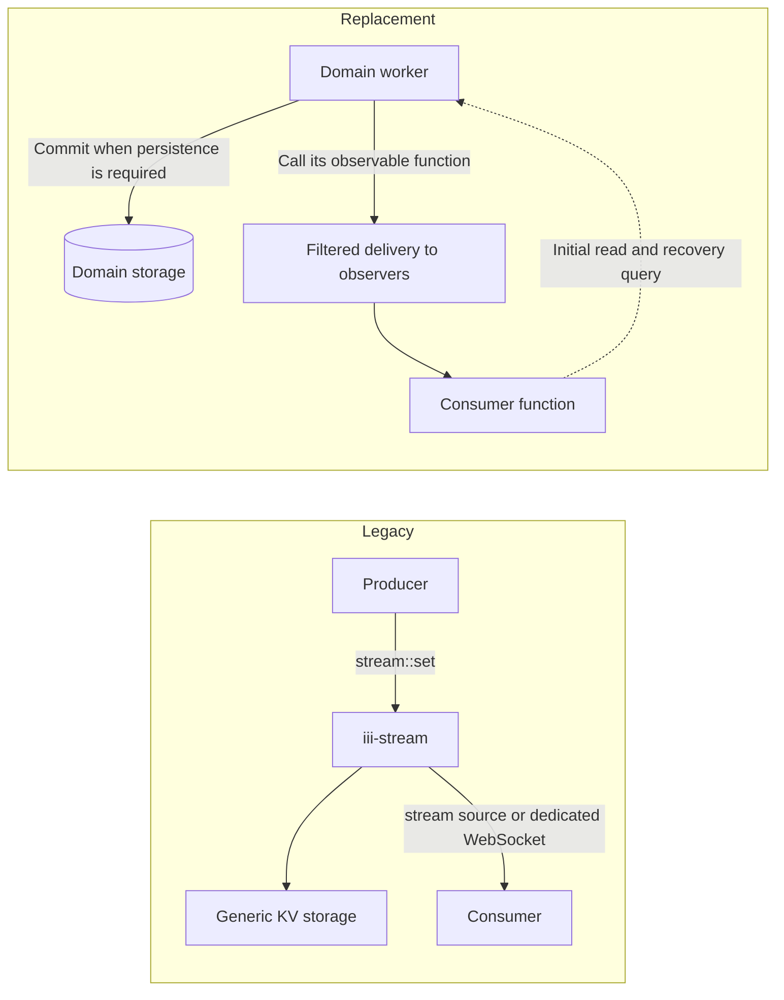

<Warning title="Deprecated">
  `iii-stream` is deprecated (iii-stream) and will be removed in an upcoming release. `pubsub` is
  deprecated (pubsub) and will be removed in an upcoming release. Behavior is unchanged for now.
  This page is the migration guide.
</Warning>

Use this page to move each `iii-stream` and `pubsub` use case to primitives every SDK ships:
observable functions your workers host, explicit storage with queries, channels, and the durable
queue. The sections below also list why both are deprecated and what stays supported.

## Why they are deprecated

`iii-stream` bundles three concerns behind one API: a generic key/value store, a change
notification, and a dedicated WebSocket transport. Every `stream::set` writes to storage even when
the caller only wanted to notify someone, stored items have no owner that can bound or clean them
up, and consumers depend on the stream envelope instead of a domain contract. Authorization is
handled by a separate `auth_function` that only covers the dedicated WebSocket.

The `pubsub` worker is a global topic bus. Its topics are free strings that no worker owns, and
`publish` delivers fire-and-forget with silent drops.

The replacements exist in Node, Browser, Python, Rust and Go: function registration with observer
hooks, observers, channels, the `state` and `database` workers, and the `queue` worker. They put
each concern with the worker that owns the data.

<Note>
  Do not replace `stream::set` with `state::set` mechanically. That keeps the storage cost of
  writing every event and loses the notification. Pick the recipe below that matches what the data
  is for.
</Note>

## Timeline and support window

| Phase             | What happens                                                                                                                | When                                            |
| ----------------- | --------------------------------------------------------------------------------------------------------------------------- | ----------------------------------------------- |
| Deprecation (now) | Everything keeps working. Engine, SDKs and the `pubsub` worker emit deprecation warnings. Response contracts do not change. | Now                                             |
| Support window    | Migrate producers and consumers together.                                                                                   | Until the removal release                       |
| Removal           | A separately announced breaking release removes `iii-stream`, its SDK helpers and the `pubsub` worker.                      | An upcoming release, announced in the changelog |

What the warnings look like:

- **Engine:** a `warn` log with target `iii::deprecation` the first time a caller uses a deprecated
  function or connects to the dedicated Streams WebSocket, then at most once every 10 minutes per
  entry point and caller. Function calls are keyed by the calling worker; WebSocket connections are
  keyed by client IP. Starting `iii-stream` and its WebSocket listener warns once per process. The
  log names the entry point, the calling worker when known and this guide. It never contains
  payloads, stream, group or item ids, headers or query strings. Direct calls such as
  `call({ function_id: "stream::set" })` from any SDK version are covered. When `iii-stream` is not
  running, a `stream::*` call still fails with `function_not_found` (code unchanged), and the
  message now explains how to enable `iii-stream` and links this guide.
- **Node and Browser SDKs:** `@deprecated` JSDoc on `createStream` and `IStream`, so editors strike
  them through. No runtime change.
- **Python SDK:** calling `create_stream` or subclassing `IStream` emits a `FutureWarning` pointing
  at your call site. Nothing is raised and behavior is unchanged.
- **Rust SDK:** `#[deprecated]` on the legacy stream helpers, `IStream`, and `create_stream`.
- **pubsub worker:** the worker logs a warning once at startup, and on `publish`, at most once every
  10 minutes per caller. Traffic on topic `stream.events`, used by the engine's own `iii-stream`
  bridge, never warns.

## What is deprecated and what is not

Deprecated with `iii-stream`:

- The `iii-stream` engine worker.
- Functions `stream::set`, `stream::get`, `stream::delete`, `stream::list`, `stream::list_groups`,
  `stream::list_all`, `stream::send` and `stream::update`.
- Its event sources `stream::on-changed`, `stream::on-join` and `stream::on-leave`.
- The dedicated Streams WebSocket listener (default `127.0.0.1:3112`) and its clients.
- The `auth_function` setting of `iii-stream`.
- SDK helpers: Node and Browser `createStream` and `IStream`; Python `create_stream` and `IStream`;
  the Rust legacy stream provider and helpers; models that only exist for the legacy Streams
  contract.

Deprecated with `pubsub` (the registry worker `pubsub`, formerly `iii-pubsub`):

- Function `pubsub::publish`, which subscribers observe with a filter on `input.topic`, and the
  `pubsub` configuration entry.

Not deprecated, keep using them:

- Function registration, observer hooks, and `observe` in every SDK.
- [Channels](../creating-workers/channels), channel readers and writers, and `StreamChannelRef`.
- `StreamRequest` and `StreamResponse` used for request/response streaming.
- `UpdateOp`, `MergePath`, `UpdateOpError`, and the Rust `StreamSetResult`, `StreamUpdateResult` and
  `StreamDeleteResult` types. The `state` worker uses them.
- The `auth_function_id` of `iii-worker-manager` and `rbac-proxy`. That is connection authorization
  for RBAC listeners, unrelated to the `iii-stream` `auth_function`. See
  [Access Control](../creating-workers/worker-manager).
- The `queue` worker, including `iii::durable::publish` and `queue::on-message`.
- Provider token streaming in LLM workers, which already uses channels.

## Choose a replacement

| Existing requirement                    | Replacement                                                                        |
| --------------------------------------- | ---------------------------------------------------------------------------------- |
| Ephemeral change/lifecycle notification | Observable function the domain worker hosts + consumer functions that observe it   |
| Queryable records with live updates     | Explicit storage + get/paginated list + change function; initial read and recovery |
| Continuous content for one operation    | Channel with explicit lifetime and bounded buffering                               |

An observer is a notification mechanism, not a database or durable event log. If history or replay
is required, define and retain the source of truth in the worker that owns the data. Do not build
another generic, unbounded event store. Prefer small notification payloads plus a query for large
datasets, or bounded record snapshots with a revision.



Find your current usage:

| You use today                                                                                     | Move to                                                                                  |
| ------------------------------------------------------------------------------------------------- | ---------------------------------------------------------------------------------------- |
| `stream::set` or `stream::send` only to tell consumers something happened                         | [Recipe 1: ephemeral notifications](#recipe-1-ephemeral-notifications)                   |
| `stream::set`, `stream::get` and `stream::list` as storage that a UI or worker watches            | [Recipe 2: stored records with live updates](#recipe-2-stored-records-with-live-updates) |
| `stream::set` or `stream::send` for progress, tokens or frames of one running operation           | [Recipe 3: continuous content](#recipe-3-continuous-content-for-one-operation)           |
| `createStream`, `create_stream` or `IStream`                                                      | Recipe 2, with storage functions your worker owns                                        |
| Join and leave events (`stream::on-join`, `stream::on-leave`) or the `iii-stream` `auth_function` | [Authorization and tenant isolation](#authorization-and-tenant-isolation)                |
| The dedicated Streams WebSocket (port `3112`)                                                     | Browser SDK over an RBAC listener, plus one of the recipes                               |
| `pubsub::publish` and its subscribers                                                             | [Migrate from pubsub](#migrate-from-pubsub)                                              |

## Recipe 1: Ephemeral notifications

Use this when consumers need to react to something that happened and nobody needs to read it back
later: a lifecycle change, a status flip, a "work is done" signal.

The worker that produces the event hosts a function whose handler returns the event, and calls it
when the event happens. Consumers observe that function, with filters for the events they want. See
[Observable functions](../creating-workers/observable-functions) for the full API in every SDK.

Producer:

```typescript
import { registerWorker } from "iii-sdk";

const worker = registerWorker(process.env.III_URL ?? "ws://localhost:49134", {
  workerName: "orders",
});

type OrderEvent = {
  order_id: string;
  status: "created" | "shipped" | "cancelled";
  revision: number;
};

// A closed schema: a filter path that is not in the event fails when the observer is created.
const ORDER_EVENT = {
  type: "object",
  additionalProperties: false,
  required: ["order_id", "status", "revision"],
  properties: {
    order_id: { type: "string" },
    status: { enum: ["created", "shipped", "cancelled"] },
    revision: { type: "integer" },
  },
};

worker.registerFunction("orders::on-event", (event: OrderEvent) => event, {
  description: "One call per order lifecycle change. Filter on input.status.",
  request_format: ORDER_EVENT,
  response_format: ORDER_EVENT,
  private: true, // only this worker makes order events
});

export async function emitOrderEvent(event: OrderEvent): Promise<void> {
  // One call per event: iii delivers it to every observer whose filters match.
  await worker.call({ function_id: "orders::on-event", payload: event });
}
```

Consumer:

```typescript
worker.registerFunction("notify::order-shipped", async (event: OrderEvent) => {
  // Idempotent: the producer may announce the same change twice.
  return { notified: event.order_id };
});

worker.observe(
  {
    function_id: "orders::on-event",
    filters: { "input.status": { $eq: "shipped" } },
    deliver: "input",
  },
  "notify::order-shipped",
);
```

A consumer that observes before the producer is connected stays `pending` and becomes `active` when
the producer registers `orders::on-event`. See
[Observer states](../using-iii/observers#observer-states).

## Recipe 2: Stored records with live updates

Use this when consumers need the current data and also want to know when it changes: a dashboard, a
list view, a sync job. Storage and notification are two separate things owned by the same domain
worker.

1. Store records in storage the domain worker owns (`state`, `database`, or your own store), with a
   revision number per record.
2. Expose read functions: `orders::get` and a paginated `orders::list` (cursor plus limit).
3. After the write is committed, call a small change notification function the domain worker hosts
   (`orders::on-changed` with `{ order_id, revision }`), built as in Recipe 1.
4. Consumers observe first, then do an initial read, then apply notifications. They repeat the read
   to recover after a reconnect.

Producer write path:

```typescript
worker.registerFunction(
  "orders::update",
  async (input: { order_id: string; patch: Record<string, unknown> }) => {
    const current = await worker.call<{ scope: string; key: string }, Order | null>({
      function_id: "state::get",
      payload: { scope: "orders", key: input.order_id },
    });
    const next: Order = {
      ...(current ?? { order_id: input.order_id }),
      ...input.patch,
      revision: (current?.revision ?? 0) + 1,
    };
    await worker.call({
      function_id: "state::set",
      payload: { scope: "orders", key: input.order_id, value: next },
    });
    // Notify only after the write succeeded. A failed write must not notify anyone.
    await worker.call({
      function_id: "orders::on-changed",
      payload: { order_id: next.order_id, revision: next.revision },
    });
    return next;
  },
);
```

For concurrent writers to the same record, guard the write with `state::compare-and-set` or your
database's transaction so revisions stay monotonic.

Consumer:

```typescript
const applied = new Map<string, number>(); // order_id -> highest revision applied

function apply(order: Order) {
  if ((applied.get(order.order_id) ?? 0) >= order.revision) return; // duplicate or stale
  applied.set(order.order_id, order.revision);
  render(order);
}

worker.registerFunction(
  "dashboard::order-changed",
  async (change: { order_id: string; revision: number }) => {
    if ((applied.get(change.order_id) ?? 0) >= change.revision) return; // already have it
    const order = await worker.call<{ order_id: string }, Order>({
      function_id: "orders::get",
      payload: { order_id: change.order_id },
    });
    apply(order);
  },
);

// 1. Observe first so no change between the read and the observer is missed.
const changes = worker.observe(
  { function_id: "orders::on-changed", deliver: "input" },
  "dashboard::order-changed",
);
await changes.ready();

// 2. Initial read. Run it again after a reconnect to recover missed changes.
async function recover() {
  let cursor: string | undefined;
  do {
    const page = await worker.call<
      { cursor?: string; limit: number },
      { items: Order[]; next_cursor?: string }
    >({ function_id: "orders::list", payload: { cursor, limit: 100 } });
    page.items.forEach(apply);
    cursor = page.next_cursor;
  } while (cursor);
}
await recover();
```

The notification carries an id and a revision, not the record. Consumers that fall behind fetch the
latest state instead of replaying every change, and large records never travel to observers.

## Recipe 3: Continuous content for one operation

Use this for content produced by one running operation and read by one reader: progress output,
tokens, frames, a file. A [channel](../understanding-iii/channels) has an explicit lifetime and
backpressure, and nothing is stored.

The reader creates the channel and passes the writer ref to the function that produces the content:

```typescript
// Reader
const channel = await worker.createChannel();
const done = worker.call({
  function_id: "reports::export",
  payload: { report_id: "r-42", writer: channel.writerRef },
});
// `done` can reject while the loop runs: mark it handled now; `await done` below still throws.
done.catch(() => {});
for await (const chunk of channel.reader.stream) {
  render(chunk);
}
await done;
```

```typescript
// Producer
import { once } from "node:events";
import type { ChannelWriter } from "iii-sdk";

worker.registerFunction(
  "reports::export",
  async (input: { report_id: string; writer: ChannelWriter }) => {
    try {
      for await (const row of readRows(input.report_id, { maxRows: 10_000 })) {
        // Respect backpressure: wait for drain instead of buffering without limit.
        if (!input.writer.stream.write(JSON.stringify(row) + "\n")) {
          await once(input.writer.stream, "drain");
        }
      }
    } catch (err) {
      // Abort instead of ending, so the reader gets an error, not a stream that looks complete.
      input.writer.stream.destroy();
      throw err;
    }
    input.writer.stream.end();
    return { ok: true };
  },
);
```

Rules for channels:

- One channel per operation and reader. For fan-out to many consumers, use Recipe 1 or 2 instead.
- End the writer when the operation finishes. If it fails, call `input.writer.stream.destroy()`
  instead of ending it, then rethrow, so the reader gets an error, not a stream that looks complete.
  Pass no argument: `destroy(err)` emits an `'error'` event that crashes the worker when nothing
  listens for it. A producer whose writer socket never opened (it failed before its first write or,
  in Node, right after one, while the socket was still connecting) never reached the engine, so the
  reader is not told: its loop ends normally only when the engine drops the unused channel after the
  channel TTL (about 5 to 6 minutes), and only the rejected `done` reports the failure. When the
  reader leaves, the engine closes the writer. See
  [Backpressure and lifecycle](../understanding-iii/channels#backpressure-and-lifecycle).
- Bound the content: cap size or duration, and never queue an unbounded backlog for a slow reader.
- For bidirectional traffic, create two channels.

## Provider and consumer obligations

`iii-stream` hid these responsibilities. With an observable function, iii stores the observers,
applies their filters and policy (`max_in_flight`, queue limits, `observers.max_per_function`), and
delivers in each observer's namespace with its metadata. The rest belongs to your code.

The provider (the worker that hosts the function):

- **Declares the event.** Give the function a closed `request_format` and `response_format`, so a
  filter path that is not in the event fails when the observer is created (`INVALID_FILTER_PATH`).
- **Keeps the event to itself.** Register the function with `private: true`, so only the provider
  can make the event.
- **Validates args, when it takes any.** Declare `args_format`, and reject an observer for any other
  reason by throwing `ObserveRejection` from `onObserverAdded`. Never let args widen what the
  consumer is allowed to see.
- **Emits after commit.** For stored data, notify only after the mutation is durable. Never report
  success while dropping data or events.

The consumer (the worker that observes the function):

- **Handles duplicates and gaps.** iii delivers each call at most once and counts what it drops in
  `iii.observer.dropped.total`, and a producer may announce the same change twice. Make handlers
  idempotent.
- **Tracks revisions or cursors.** Ignore notifications older than what it already applied.
- **Recovers after reconnect.** Re-run the initial read (Recipe 2) because notifications sent while
  it was away are not replayed.
- **Cleans up.** Dispose observers it no longer needs and close channels it opened.

## Authorization and tenant isolation

A transport change alone does not reproduce the old policies. Moving a client from the dedicated
Streams WebSocket to a Browser SDK observer of `stream::on-changed` changes the connection, not the
dependency on `iii-stream`, and it keeps the deprecated sources.

| Legacy mechanism                                                                                                    | Replacement                                                                                                                                                                                                                                                                                                |
| ------------------------------------------------------------------------------------------------------------------- | ---------------------------------------------------------------------------------------------------------------------------------------------------------------------------------------------------------------------------------------------------------------------------------------------------------- |
| `iii-stream` `auth_function` (authorizes dedicated WebSocket connections and stamps `context` on join/leave events) | Connection authorization by `iii-worker-manager` or `rbac-proxy`: `auth_function_id` runs once per connection and returns an `AuthResult` with `namespaces`, `allowed_functions`, `forbidden_functions` and a `context` forwarded to middleware. See [Access Control](../creating-workers/worker-manager). |
| `stream::on-join` (a subscriber arrived, optionally rejected)                                                       | The provider's `onObserverAdded` hook. It sees the observer's id, target function, `args` and filters, and rejects the observer by throwing `ObserveRejection`.                                                                                                                                            |
| `stream::on-leave` (a subscriber left)                                                                              | The provider's `onObserverRemoved` hook, which also runs when the observer is disposed after its worker disconnected.                                                                                                                                                                                      |
| Per-subscription authorization in join handlers                                                                     | The session's grants: a session may observe a function only when it may invoke the function and the target, and the `on_observer_registration_function_id` hook can rewrite or deny each observer. Validation inside `onObserverAdded` adds the provider's own rules.                                      |

For tenant isolation, give each tenant or browser session its own namespace through the RBAC
listener's `namespaces` grant, so a session observes only the functions granted to it, and run the
provider for each tenant in that tenant's namespace. An observer's `args` and filters come from the
consumer: never treat a tenant id taken from them as proof of the tenant.

<Note>
  The `auth_function_id` of `iii-worker-manager` and `rbac-proxy` is **not** deprecated. Only the
  `auth_function` of `iii-stream` and its `stream::on-join` / `stream::on-leave` sources are.
</Note>

## A note on stream::send

`stream::send` already avoids the key/value write that `stream::set` does, but it still runs through
`iii-stream` and is deprecated with it. Changing `stream::set` to `stream::send` is not the final
migration, and it changes the event envelope consumers receive. Move straight to Recipe 1 or
Recipe 3.

## Migrate from pubsub

| Use case                                                             | Replacement                                                                                                                                                    | What changes                                                                                                                                             |
| -------------------------------------------------------------------- | -------------------------------------------------------------------------------------------------------------------------------------------------------------- | -------------------------------------------------------------------------------------------------------------------------------------------------------- |
| Fan-out of a domain event to several consumers                       | An observable function the producer hosts (Recipe 1). The producer registers, for example, `link::on-created` and calls it after commit.                       | Consumers observe the producer's function, with filters on the event, where they subscribed to a free topic string. The producer owns the event's shape. |
| Delivery must not be lost (retries, dead letters)                    | `queue` worker: publish with `iii::durable::publish`, and consume by observing `queue::on-message` with `{ topic }`. See [Queues](../creating-workers/queues). | Every message is persisted; delivery is at-least-once, so handlers must be idempotent. Requires the `queue` worker.                                      |
| Generic topic bus where producer and consumer do not know each other | Queue topics through `iii::durable::publish`, or a small domain events worker that hosts an observable function, with consumers filtering on `input.topic`.    | **Gap:** no non-durable, generic topic-string bus replaces `pubsub`. Pick durable queue topics or a function of your own.                                |
| Broadcast across engine instances (`redis` adapter)                  | `queue` worker with a `redis` or `rabbitmq` adapter, or a producer that runs per instance and owns delivery.                                                   | Observers are delivered within one engine.                                                                                                               |

Things to check while migrating:

- **Payload envelope.** `pubsub` and `queue::on-message` deliver the published `data` as-is. An
  observable function defines its own payload, and its observers receive the `Observed` envelope
  unless they set `deliver: "input"` or `deliver: "output"`, so update consumer handlers.
- **Namespaces.** `pubsub` ignored namespaces: topics were global and subscriber functions resolved
  in the `default` namespace. Observers name the namespace of the function they observe and of their
  target, so a consumer in another namespace names it.
- **Silent drops.** A `publish` sent with `CallAction.Void()` when no `pubsub` worker is running is
  dropped without an error to the caller. The replacements make delivery explicit; do not rely on
  that behavior.
- **Order of removal.** The `iii-stream` `bridge` adapter uses `pubsub` internally. If you run it,
  keep `pubsub` until `iii-stream` is gone.

## Existing stream data

During the support window, data stored by `iii-stream` stays readable through `stream::get`,
`stream::list` and `stream::list_groups`. To keep it, copy what you still need into storage your
domain worker owns while `iii-stream` is running, and map stream, group and item ids to your own
keys. Do not delete the `iii-stream` store files or Redis keys until your consumers run without
`iii-stream`.

A documented export path, the id mapping and a rollback plan are part of the removal phase and will
be published before storage access is removed in an upcoming release.

## Worked examples in the tutorials

The Linkly tutorial and the real-time todo how-to use observable functions and the `queue` worker:

- [Ch. 5: Stream live clicks](../tutorials/linkly/streaming) is a worked example of Recipe 2. The
  `click-streamer` worker hosts `click-streamer::on-click` and calls it for each click after its row
  is committed, and `link::click_summary` gives a late listener the current total.
- [Ch. 7: Bring in the browser](../tutorials/linkly/frontend) observes that function from the
  Browser SDK through `rbac-proxy`, reads the total first, and reads it again after a reconnect.
- [Ch. 4: Make it durable](../tutorials/linkly/durable-execution) fans `link.created` and
  `link.updated` out on durable topics with `iii::durable::publish` and `queue::on-message`.
- [Build a real-time todo app](../how-to/build-a-realtime-todo-app) outlines Recipe 2 for a browser
  app: stored todos, `todos::get` and `todos::list`, and a `todos::on-changed` function each browser
  observes.

## Checklist

- [ ] List every call to `stream::*` and `pubsub::publish`, and every observer of
      `stream::on-changed`, `stream::on-join`, `stream::on-leave` and `pubsub::publish`, including
      calls whose failures your code ignores.
- [ ] Pick a recipe per use case and name the worker that owns each piece of data.
- [ ] Move authorization to the RBAC listener and the provider's `onObserverAdded` validation.
- [ ] Migrate producers and their consumers together. If you must publish to both paths for a while,
      define event identity, which consumer reads which path, and a deadline.
- [ ] Copy any stream data you still need into domain storage.
- [ ] Run your consumers with `iii-stream` and `pubsub` absent from `worker-compose.yaml` and
      confirm no deprecation warnings remain in the engine log.
