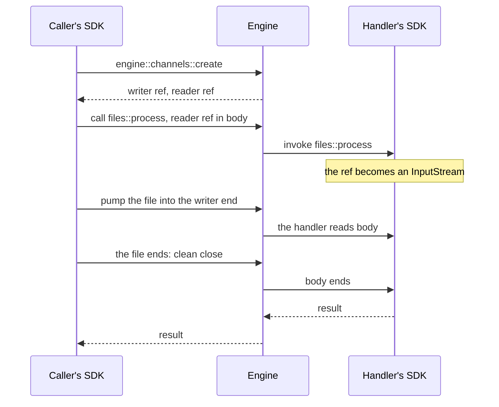

A stream is a value in a call's payload or result. Use a stream for data that is larger than the
JSON message limit, or for data that the sender makes over time. For small JSON values, use a
regular `worker.call(...)`.

The function on the other side receives an `InputStream` to read or an `OutputStream` to write. The
two functions can run in different processes and languages.

<Note>
  The examples use the stream API of the 0.27 SDKs. To write the functions that receive and return
  streams, see [Creating workers / Streaming](../creating-workers/streaming). To move code from the
  channel API, see [Upgrading from 0.26.x](../upgrading/from-0-26-x).
</Note>

## How a stream works

A typical call is one JSON message. A message has a size limit, the sender must have all of the
required data before it starts sending, and both the sender and the receiver must keep all of it in
memory.

Streams are different because they don't have size limits, don't need all of the data they're
sending ahead of time, and neither the sender nor the receiver need to keep the full payload in
memory. Instead when you create a stream the call will send a reference to the receiver and the
receiver can use that reference to access the stream.

| Term           | Meaning                                                                                      |
| -------------- | -------------------------------------------------------------------------------------------- |
| `InputStream`  | The end you read. A source in a payload or a result arrives as an `InputStream`.             |
| `OutputStream` | The end you write. A sink in a payload or a result arrives as an `OutputStream`.             |
| Pipe           | The connection in the engine that carries one stream from one writer to one reader.          |
| Ref            | `{ channel_id, access_key, direction }`, the JSON value that replaces a stream in the call.  |
| `StreamInfo`   | `{ stream: true, direction, id }`, the value an observer receives in place of a live stream. |

A `read` ref becomes an `InputStream`, and a `write` ref becomes an `OutputStream`. A pipe carries
data in one direction. For a two-way exchange, use two streams.

This is the flow when a caller sends `report.csv` to `files::process`:



A source uses the pipe like this:

1. The caller's SDK finds the file in the payload and creates a pipe for it.
2. The SDK puts the reader ref in place of the file, sends the call with the reader ref.
3. The handler's SDK turns the ref into an `InputStream` and reads from the pipe.

A sink uses the pipe in the other direction:

1. The caller's SDK sends the writer ref and creates a pipe for it.
2. The SDK puts the writer ref in place of the file, sends the call with the writer ref.
3. The handler's SDK turns the ref into an `OutputStream` and writes to the pipe.

<Note>
  The engine internally calls a pipe a channel. They are the same thing. It creates a pipe with `engine::channels::create` and carries
  it over `/ws/channels/<id>` sockets, so traces and the engine protocol show `channels`.
</Note>

## Send a stream in a call

Put the stream in the payload. The SDK creates a pipe for it, sends a ref in its place, and writes
the data into the pipe while the call runs. Strings, buffers, plain objects, and arrays stay JSON.
The comment in each tab lists the values that SDK sends as streams.

<Tabs>
  <Tab title="Node / TypeScript">
    ```typescript
    import { createReadStream } from "node:fs";
    import { registerWorker } from "iii-sdk";

    const worker = registerWorker(process.env.III_URL ?? "ws://localhost:49134");

    // Streams: an InputStream, a Node Readable, a Web ReadableStream, a Blob or File, or an async
    // generator object. InputStream.from(...) wraps a Uint8Array, a string, or an iterable or async
    // iterable of either.
    const result = await worker.call({
      function_id: "files::process",
      payload: { filename: "report.csv", body: createReadStream("report.csv") },
    });
    ```

  </Tab>
  <Tab title="Python">
    ```python
    from iii import InputStream, register_worker

    worker = register_worker("ws://localhost:49134")


    # Streams: an InputStream, an async generator object, or a binary file object opened for reading.
    # InputStream.from_file(path), InputStream.from_iter(iterable) (sync or async, of bytes or str),
    # and InputStream.from_bytes(data) build one.
    async def upload() -> dict:
        return await worker.call_async(
            {
                "function_id": "files::process",
                "payload": {"filename": "report.csv", "body": InputStream.from_file("report.csv")},
            }
        )
    ```

  </Tab>
  <Tab title="Rust">
    ```rust
    use iii_sdk::{CallRequest, InputStream};
    use serde_json::json;
    use tokio::fs::File;

    // Streams: an InputStream built with from_reader (an AsyncRead), from_stream (a Stream of
    // Result<Bytes, E>), or from_bytes. Other serde values stay JSON.
    let result = worker
        .call(CallRequest::new(
            "files::process",
            json!({
                "filename": "report.csv",
                "body": InputStream::from_reader(File::open("report.csv").await?),
            }),
        ))
        .await?;
    ```

  </Tab>
  <Tab title="Go">
    ```go
    // Streams: an *iii.InputStream built with iii.InputStreamFromReader (an io.Reader, closed at the
    // end when it is an io.Closer) or iii.InputStreamFromBytes. Other values stay JSON.
    file, err := os.Open("report.csv")
    if err != nil {
    	return err
    }
    payload, err := json.Marshal(map[string]any{
    	"filename": "report.csv",
    	"body":     iii.InputStreamFromReader(file),
    })
    if err != nil {
    	return err
    }
    result, err := worker.Call(ctx, iii.CallRequest{FunctionID: "files::process", Payload: payload})
    ```

  </Tab>
</Tabs>

A call can carry any number of streams, in any field. The SDK creates their pipes in parallel before
it sends the call. If it cannot create a pipe, the call fails and is not sent.

The worker that sends a stream owns its pipe. Keep the worker connected until the other side has
attached to its end. See [Pipe ownership](#pipe-ownership).

## Read a stream from a result

A stream in a function's result arrives as an `InputStream` in the same field.

<Tabs>
  <Tab title="Node / TypeScript">
    ```typescript
    import type { InputStream } from "iii-sdk";

    const { csv }: { csv: InputStream } = await worker.call({
      function_id: "reports::export",
      payload: { report_id: "r-42" },
    });
    for await (const line of csv.lines()) console.log(line);
    ```

  </Tab>
  <Tab title="Python">
    ```python
    result = await worker.call_async(
        {"function_id": "reports::export", "payload": {"report_id": "r-42"}}
    )
    async for line in result["csv"].lines():
        print(line)
    ```

  </Tab>
  <Tab title="Rust">
    ```rust
    use futures::TryStreamExt;
    use iii_sdk::{CallRequest, InputStream};
    use serde::Deserialize;
    use serde_json::json;

    #[derive(Deserialize)]
    struct Export {
        report_id: String,
        csv: InputStream,
    }

    let export: Export = serde_json::from_value(
        worker
            .call(CallRequest::new("reports::export", json!({ "report_id": "r-42" })))
            .await?,
    )?;
    // A decoded stream binds to the only client in the process.
    // With several clients in one process, call export.csv.bind(&worker) before reading.
    let mut lines = export.csv.lines();
    while let Some(line) = lines.try_next().await? {
        println!("{line}");
    }
    ```

  </Tab>
  <Tab title="Go">
    ```go
    type export struct {
    	ReportID string           `json:"report_id"`
    	CSV      *iii.InputStream `json:"csv"`
    }

    out, err := worker.Call(ctx, iii.CallRequest{
    	FunctionID: "reports::export",
    	Payload:    json.RawMessage(`{"report_id":"r-42"}`),
    })
    if err != nil {
    	return err
    }
    // A stream unmarshalled from a call's result binds to that client. A stream unmarshalled from
    // other JSON binds to the only client in the process; with several, call stream.Bind(worker).
    var res export
    if err := json.Unmarshal(out, &res); err != nil {
    	return err
    }
    for line, err := range res.CSV.Lines(ctx) {
    	if err != nil {
    		return err
    	}
    	fmt.Println(line)
    }
    ```

  </Tab>
</Tabs>

## Read and write a stream

A stream has one reader. Read an `InputStream` once, in the form that fits the data:

| To                                | Call                                                                  |
| --------------------------------- | --------------------------------------------------------------------- |
| Read byte chunks                  | `for await (const chunk of s)`                                        |
| Read all the data                 | `await s.bytes()`, `await s.text()`                                   |
| Read lines, without the newline   | `for await (const line of s.lines())`                                 |
| Read JSON messages                | `for await (const msg of s.messages<T>())`                            |
| Read bytes and messages, in order | `for await (const frame of s.frames())`                               |
| Stop reading                      | `await s.cancel()`                                                    |
| Make two copies                   | `s.tee()`, before the first read                                      |
| Use a native API                  | `s.toReadable()` for a Node `Readable`, `s.toWebStream()` for the Web |

Write an `OutputStream`:

| To                  | Call                                                                      |
| ------------------- | ------------------------------------------------------------------------- |
| Write bytes         | `await out.write(chunk)`, a `Uint8Array` or a string as UTF-8 bytes       |
| Send a JSON message | `await out.send(value)`                                                   |
| Finish              | `await out.close()`                                                       |
| Fail                | `await out.abort(reason)`                                                 |
| Use a native API    | `out.toWritable()` for a Node `Writable`, `out.toWebStream()` for the Web |

A pipe carries bytes in binary frames and messages in text frames. Byte reads skip messages, and
`messages()` skips bytes. `frames()` yields both in the order they were sent: a frame is
`{ type: "binary", value }` or `{ type: "text", value }`. A text frame that is not JSON reaches
`messages()` as its raw string.

`write` and `send` resolve when the chunk is accepted. A loop of awaited writes thus follows the
reader's speed and does not buffer without limit. Each end opens its socket when it is first read or
written.

<Note>
  The SDK reference gives the same operations for each SDK: [Node](../reference/sdk-node),
  [Python](../reference/sdk-python), [Rust](../reference/sdk-rust), [Go](../reference/sdk-go), and
  [Browser](../reference/sdk-browser).
</Note>

### Read a stream more than once

A second read of the same `InputStream` fails with `STREAM_IN_USE`. To read the data twice, call
`tee()` before the first read. The two copies are in the same process.

<Tabs>
  <Tab title="Node / TypeScript">
    ```typescript
    import { createHash } from "node:crypto";
    import { createWriteStream } from "node:fs";
    import { pipeline } from "node:stream/promises";

    const [forHash, forFile] = body.tee();
    const hash = createHash("sha256");
    // Read both copies at the same time
    await Promise.all([
      pipeline(forHash.toReadable(), hash),
      pipeline(forFile.toReadable(), createWriteStream("report.csv")),
    ]);
    ```

  </Tab>
  <Tab title="Python">
    ```python
    import asyncio
    import hashlib

    for_hash, for_file = body.tee()


    async def digest() -> str:
        h = hashlib.sha256()
        async for chunk in for_hash:
            h.update(chunk)
        return h.hexdigest()


    async def save() -> None:
        with open("report.csv", "wb") as file:
            async for chunk in for_file:
                file.write(chunk)


    # Read both copies at the same time
    sha, _ = await asyncio.gather(digest(), save())
    ```

  </Tab>
  <Tab title="Rust">
    ```rust
    // There is no tee(): read the stream once, and use each chunk twice
    let mut hasher = Sha256::new();
    let mut file = File::create("report.csv").await?;
    let mut chunks = body;
    while let Some(chunk) = chunks.try_next().await? {
        hasher.update(&chunk);
        file.write_all(&chunk).await?;
    }
    ```

  </Tab>
  <Tab title="Go">
    ```go
    // There is no tee(): read the stream once, and copy it with io.TeeReader or io.MultiWriter
    file, err := os.Create("report.csv")
    if err != nil {
    	return err
    }
    defer file.Close()
    hash := sha256.New()
    if _, err := io.Copy(io.MultiWriter(file, hash), body); err != nil {
    	return err
    }
    ```

  </Tab>
</Tabs>

The copies share a buffer of 16 frames. When one copy is 16 frames behind the other, the faster copy
waits. If you read one copy to the end before you start the other, the read never finishes.

## Receive data into a sink

To receive the data into a destination you already have, such as a file, pass it as a sink. The
function receives it as an `OutputStream`. The call resolves after the sink has received all the
data.

<Tabs>
  <Tab title="Node / TypeScript">
    ```typescript
    import { createWriteStream } from "node:fs";

    // Sinks: an OutputStream, a Node Writable (not a Duplex), or a Web WritableStream
    await worker.call({
      function_id: "reports::render-pdf",
      payload: { report_id: "r-42", out: createWriteStream("r-42.pdf") },
    });
    ```

  </Tab>
  <Tab title="Python">
    ```python
    from iii import OutputStream

    # Sinks: an OutputStream built with OutputStream.to_file(path), or with OutputStream.to(writer),
    # where writer is a binary file object, an asyncio StreamWriter, or an object with a write method
    await worker.call_async(
        {
            "function_id": "reports::render-pdf",
            "payload": {"report_id": "r-42", "out": OutputStream.to_file("r-42.pdf")},
        }
    )
    ```

  </Tab>
  <Tab title="Rust">
    ```rust
    use iii_sdk::{CallRequest, OutputStream};
    use serde_json::json;
    use tokio::fs::File;

    // Sinks: an OutputStream built with to_writer (an AsyncWrite)
    worker
        .call(CallRequest::new(
            "reports::render-pdf",
            json!({
                "report_id": "r-42",
                "out": OutputStream::to_writer(File::create("r-42.pdf").await?),
            }),
        ))
        .await?;
    ```

  </Tab>
  <Tab title="Go">
    ```go
    // Sinks: an *iii.OutputStream built with iii.OutputStreamToWriter (an io.Writer). When the stream
    // ends, the SDK calls the writer's Flush() error method if it has one, and closes an io.Closer.
    // When the stream aborts, the SDK closes only a writer with a CloseWithError method.
    file, err := os.Create("r-42.pdf")
    if err != nil {
    	return err
    }
    defer file.Close() // covers a failed call
    payload, err := json.Marshal(map[string]any{"report_id": "r-42", "out": iii.OutputStreamToWriter(file)})
    if err != nil {
    	return err
    }
    _, err = worker.Call(ctx, iii.CallRequest{FunctionID: "reports::render-pdf", Payload: payload})
    ```

  </Tab>
</Tabs>

A sink receives bytes only, and drops the messages the function sends. To receive messages too, pass
the output of a [pipe](#create-a-pipe) instead.

### Sink errors

- If the stream into a sink aborts, the call fails with `STREAM_ABORTED`, also when the function
  returned a result.
- If the sink fails, for example on a full disk, the SDK stops the copy. The call fails with
  `STREAM_ABORTED`, with the reason `the sink failed: ...` and the sink's error as its cause. The
  function's next write fails with `STREAM_CLOSED`.
- If the call fails, the SDK stops the copy and closes the sink with the error.

In each case, the sink can hold part of the data. Remove a partly written file.

### Sink timeout

The call's `timeoutMs` includes the copy into its sinks, from the start of the call. If the timeout
expires before a sink is complete, the SDK aborts the open sinks and the call fails with `TIMEOUT`.
Set a longer timeout when a sink fills slowly, for example when the function writes after it
returns.

A call whose result contains a stream for the caller to write to does not wait for its sinks. The
sinks can depend on what the caller writes next.

## Create a pipe

`worker.pipe()` returns a pipe with two ends, `input` and `output`. Put one end in a payload and use
the other end yourself. Use a pipe when a stream value is not sufficient:

- To give out a stream before its data exists.
- To give a stream to a call that you make later.
- To receive messages, which a sink drops.
- For a two-way exchange, with two pipes.

A sink holds the call until the stream ends. A pipe end does not: the call resolves when the
function returns.

<Tabs>
  <Tab title="Node / TypeScript">
    ```typescript
    // Give the function the output, and read the messages from the input
    const { input, output } = await worker.pipe();
    const done = worker.call({
      function_id: "llm::complete",
      payload: { prompt: "Summarize report r-42", tokens: output },
    });
    // `done` can reject while the loop runs: mark it handled now; `await done` below still throws.
    done.catch(() => {});
    for await (const { token } of input.messages<{ token: string }>()) process.stdout.write(token);
    await done;
    ```

  </Tab>
  <Tab title="Python">
    ```python
    import asyncio

    # Give the function the output, and read the messages from the input
    pipe = await worker.pipe_async()
    call = asyncio.create_task(
        worker.call_async(
            {
                "function_id": "llm::complete",
                "payload": {"prompt": "Summarize report r-42", "tokens": pipe.output},
            }
        )
    )
    async for message in pipe.input.messages():
        print(message["token"], end="", flush=True)
    await call
    ```

  </Tab>
  <Tab title="Rust">
    ```rust
    use futures::TryStreamExt;
    use iii_sdk::{CallRequest, Error};
    use serde::Deserialize;
    use serde_json::json;

    #[derive(Deserialize)]
    struct Token {
        token: String,
    }

    // Give the function the output, and read the messages from the input while the call runs
    let pipe = worker.pipe().await?;
    let call = worker.call(CallRequest::new(
        "llm::complete",
        json!({ "prompt": "Summarize report r-42", "tokens": pipe.output }),
    ));
    let read = async {
        let mut messages = pipe.input.messages::<Token>();
        while let Some(Token { token }) = messages.try_next().await? {
            print!("{token}");
        }
        Ok::<_, Error>(())
    };
    let (result, ()) = tokio::try_join!(call, read)?;
    ```

  </Tab>
  <Tab title="Go">
    ```go
    // Give the function the output, and read the messages from the input while the call runs.
    // Pipe uses the engine's default buffer size.
    input, output, err := worker.Pipe(ctx)
    if err != nil {
    	return err
    }
    payload, err := json.Marshal(map[string]any{"prompt": "Summarize report r-42", "tokens": output})
    if err != nil {
    	return err
    }
    readCtx, stopReading := context.WithCancel(ctx)
    defer stopReading()
    done := make(chan error, 1)
    go func() {
    	_, err := worker.Call(ctx, iii.CallRequest{FunctionID: "llm::complete", Payload: payload})
    	if err != nil {
    		stopReading() // a handler that fails before it writes leaves the output open
    	}
    	done <- err
    }()
    for msg, err := range input.Messages(readCtx) {
    	if err != nil {
    		if callErr := <-done; callErr != nil {
    			return callErr
    		}
    		return err
    	}
    	var m struct {
    		Token string `json:"token"`
    	}
    	if json.Unmarshal(msg, &m) == nil {
    		fmt.Print(m.Token)
    	}
    }
    return <-done
    ```

  </Tab>
</Tabs>

`worker.pipe({ bufferSize })` sets the number of frames that the engine buffers between the two
ends: 64 by default, 1024 at most. The worker that calls `pipe()` owns the pipe.

If the function throws before it writes to the output, the output stays open, and a reader of the
input waits until the engine drops that end. Watch the call as well as the stream: the call's error
arrives first.

## Handle aborts and errors

A stream that ends with a clean close is complete. When a stream aborts, the reader receives the
data sent before the abort, and then a `StreamAbortedError` with the code `STREAM_ABORTED`. A partly
read stream thus never looks complete. Treat the error as an incomplete transfer.

<Tabs>
  <Tab title="Node / TypeScript">
    ```typescript
    import { StreamAbortedError } from "iii-sdk";

    // An abort is an error from the read, after the data already sent
    try {
      for await (const chunk of body) await store.append(key, chunk);
    } catch (err) {
      if (err instanceof StreamAbortedError) await store.remove(key); // the upload is incomplete
      throw err;
    }
    ```

  </Tab>
  <Tab title="Python">
    ```python
    from iii import StreamAbortedError

    # An abort is an error from the read, after the data already sent
    try:
        async for chunk in body:
            await store.append(key, chunk)
    except StreamAbortedError:
        await store.remove(key)  # the upload is incomplete
        raise
    ```

  </Tab>
  <Tab title="Rust">
    ```rust
    use iii_sdk::Error;

    // An abort is Error::StreamAborted, after the data already sent
    let data = match body.read_all().await {
        Ok(data) => data,
        Err(err @ Error::StreamAborted { .. }) => {
            store.remove(&key).await; // the upload is incomplete
            return Err(err);
        }
        Err(err) => return Err(err),
    };
    ```

  </Tab>
  <Tab title="Go">
    ```go
    // An abort is an *iii.InvocationError with the code STREAM_ABORTED, after the data already sent
    if _, err := io.Copy(dst, body); err != nil {
    	var streamErr *iii.InvocationError
    	if errors.As(err, &streamErr) && streamErr.Code == iii.CodeStreamAborted {
    		store.Remove(key) // the upload is incomplete
    	}
    	return err
    }
    ```

  </Tab>
</Tabs>

The error's `reason` is the engine's text, for example
`channel writer aborted: closed with code 1011`. The engine does not send the writer's reason. The
cause of a failure arrives in the call's error or result.

### Error codes

The SDK throws an `InvocationError` with one of these codes:

- `STREAM_ABORTED`: the stream aborted before its end.
- `STREAM_CLOSED`: a write or a `send` after the stream closed, aborted, or lost its reader. Also a
  read of an `InputStream` that was cancelled by `cancel()`, by an early exit from a read loop, or
  because its handler returned.
- `STREAM_IN_USE`: a second read of an `InputStream`, the same stream twice in one payload, or a
  stream that was already read to the end or already sent.
- `STREAM_NOT_ALLOWED`: a stream in a queued call. See [Queue a call](#queue-a-call).

## Queue a call

A call sent with `CallAction.Enqueue` and a stream in its payload fails before it is sent, with the
code `STREAM_NOT_ALLOWED`. A queued call can run after its pipe expired, and a retry cannot read a
stream again. Store the data first, for example in object storage, and queue its key.

`CallAction.Void` is allowed: the call runs live, and the SDK discards only its result.

## Pipe ownership

A pipe belongs to the worker that created it: the worker that sent the source or the sink, or the
worker that called `pipe()`. Forwarding a stream does not change its owner.

When the owner disconnects, the engine releases the pipe:

- The engine drops each end that no worker has attached. A later attach with that ref fails with
  HTTP `404`.
- A reader that waits for a writer that never attached gets an error, not the end of the stream.
- A stream with both ends attached continues until it completes.

The engine drops an end that no worker attaches after approximately five minutes.

When the reader finishes or disconnects, the engine removes the pipe and any end that is not
attached. It closes an attached writer immediately, also when the writer is idle.

## Observe a call that carries a stream

A stream has one reader, and the first socket that attaches takes its end. An observer that received
the live stream could take the data before the observed function reads it.

So when an observer captures the `input` or `output` of a call that carried a stream, the target
receives a `StreamInfo` in that field: `{ stream: true, direction, id }`. It holds the pipe's id and
no access key. The other fields arrive as usual, and filters operate as usual.

<Tabs>
  <Tab title="Node / TypeScript">
    ```typescript
    import type { Observed, StreamInfo } from "iii-sdk";

    type UploadSeen = { filename: string; body: StreamInfo };

    worker.registerFunction("audit::uploads", async ({ input }: Observed<UploadSeen>) => {
      // body says a stream was passed; it holds no bytes
      console.log(`upload of ${input?.filename}`, { stream: input?.body.id });
      return null;
    });

    worker.observe({ function_id: "files::process", capture: ["input"] }, "audit::uploads");
    ```

  </Tab>
  <Tab title="Python">
    ```python
    def audit_upload(observed: dict) -> None:
        upload = observed["input"]
        # body is a StreamInfo: it says a stream was passed, and holds no bytes
        print(f"upload of {upload['filename']}", {"stream": upload["body"].id})

    worker.register_function("audit::uploads", audit_upload)
    worker.observe({"function_id": "files::process", "capture": ["input"]}, "audit::uploads")
    ```

  </Tab>
  <Tab title="Rust">
    ```rust
    use iii_sdk::{Capture, Error, Observed, RegisterFunction, Source, StreamInfo};
    use schemars::JsonSchema;
    use serde::Deserialize;

    #[derive(Deserialize, JsonSchema)]
    struct UploadSeen {
        filename: String,
        body: StreamInfo,
    }

    worker.register_function(
        "audit::uploads",
        RegisterFunction::new(|event: Observed<UploadSeen>| {
            // body is a StreamInfo: it says a stream was passed, and holds no bytes
            if let Some(upload) = &event.input {
                println!("upload of {} ({})", upload.filename, upload.body.id);
            }
            Ok::<_, Error>(())
        }),
    );

    worker.observe(
        Source::function("files::process").capture([Capture::Input]),
        "audit::uploads",
    );
    ```

  </Tab>
  <Tab title="Go">
    ```go
    type uploadSeen struct {
    	Filename string         `json:"filename"`
    	Body     iii.StreamInfo `json:"body"`
    }

    worker.RegisterFunction("audit::uploads", func(ctx context.Context, data json.RawMessage) (any, error) {
    	var event iii.Observed
    	if err := json.Unmarshal(data, &event); err != nil {
    		return nil, err
    	}
    	var upload uploadSeen
    	if err := json.Unmarshal(event.Input, &upload); err != nil {
    		return nil, err
    	}
    	// Body is a StreamInfo: it says a stream was passed, and holds no bytes
    	log.Printf("upload of %s (stream %s)", upload.Filename, upload.Body.ID)
    	return nil, nil
    })

    worker.Observe(iii.Source{FunctionID: "files::process", Capture: []iii.Capture{iii.CaptureInput}}, "audit::uploads")
    ```

  </Tab>
</Tabs>

This rule applies to the `Observed` payload that the engine builds. A function that a worker calls
through an observer receives live streams. For example, a route that the HTTP worker calls receives
a live `request_body` and `response`.

<Warning>
  The observed payload on the wire still holds the ref with its access key. A target on an SDK
  before 0.27 receives the ref. Do not open it: the first socket that attaches takes the stream from
  the observed function.
</Warning>

## Old and new SDKs

The wire protocol did not change: a 0.26 engine serves 0.27 SDKs, and the ref JSON is the same in
every SDK. Workers on old and new SDKs operate together in one project:

- A ref from a 0.26 SDK arrives in a 0.27 handler or call result as an `InputStream` or an
  `OutputStream`.
- A stream from a 0.27 SDK arrives in a 0.26 TypeScript, Python, or browser handler as a
  `ChannelReader` or a `ChannelWriter`, and in a 0.26 Go or Rust handler as the ref JSON.
