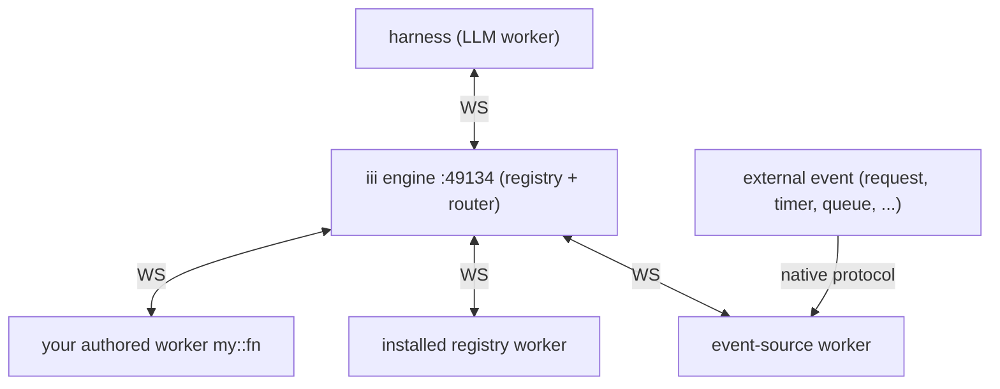

# iii

iii is a language-agnostic runtime where services, agents, and tools are composed of the same things: workers, functions, and observers. One engine process (default port `49134`) holds a live registry of every connected worker, every function those workers expose, and every observer between those functions. Workers are independent OS processes that open a WebSocket to the engine, register **Functions** (`service::name` handlers), and **observe** functions: each matching call of the observed function invokes a target function. There is no direct worker-to-worker traffic — every call routes through the engine, which makes the language, runtime, and physical location of any worker invisible to its callers.

## When to Use

Use this skill to discover live iii capabilities, call functions, author SDK workers, observe
functions, or operate project workers through Compose.

**You extend yourself by writing iii workers.** A few lines get you on the bus:

```ts
import { registerWorker } from 'iii-sdk'

const iii = registerWorker(process.env.III_ENGINE_URL!, { workerName: 'demo' })

iii.registerFunction('demo::add', async (payload: { a: number; b: number }) => {
  return { c: payload.a + payload.b }
})
```

The instant the handshake completes, `demo::add` is callable from any worker (and the harness itself) via `iii.call({ function_id: 'demo::add', payload: { a: 2, b: 3 } })`. No restart, no registration with the harness — the engine routes it automatically.

## The four primitives

| Primitive | What it is | Owned by |
|---|---|---|
| Engine | One coordinator process. Routes every invocation. | The operator |
| Worker | A process that opens a WebSocket to the engine. | Anyone who writes one |
| Function | A named handler inside a worker, id `service::name`. Stable across worker restarts. | The registering worker |
| Observer | A `(source function, filters, target function)` binding. Each matching call of the source invokes the target. | The observing worker |

Three consequences worth internalising:

1. **No worker-to-worker traffic.** Every call is `worker → engine → worker`. Workers never address each other directly. Location and language are invisible.
2. **No restart coordination.** Restarting a worker is invisible to callers as long as it re-registers the same function ids. Two workers registering the same function id = automatic load-balance.
3. **No polling unless you opt in.** Observers are the engine's push channel. When a function runs, the engine invokes the targets of its matching observers.

The function id is the only contract between any two workers.



Every edge to the engine is a WebSocket. An event-source worker terminates some native protocol — an inbound request, a timer, a queue message — and calls one of its functions (`http::on-request`, `cron::on-tick`, `queue::on-message`) once per event; observers of that function run.

## Need a capability? Discover before you build — in this order

The most common harness mistake is reimplementing something that already exists, or hardwiring one worker out of habit. Work the steps in order; stop at the first that satisfies the need.

**1. Look at what is already registered in the engine.** The capability may be one call away.

```jsonc
// engine::functions::list   — every function on this engine, across all workers.
//   Filter with { prefix: 'svc::' } or { search: 'resize' }.
// engine::workers::list      — every connected worker.
```

If a registered function fits, just call it: `iii.call({ function_id, payload })`.

**2. Search the public registry.** If nothing registered fits, look for a worker to install. This goes through the `iii-directory` worker:

```jsonc
// directory::registry::workers::list { search: 'image resize' }
//   → published workers matching the query.
// directory::registry::workers::info { name: '<worker>' }
//   → that worker's README, config keys, API reference, and skills.
```

When one fits, add it through the project's Compose daemon:

```bash
iii trigger -n <compose-namespace> compose::add worker=<worker>
```

`iii-directory` is itself a registry worker, so confirm it is connected before calling `directory::*`:

```jsonc
// engine::functions::list { prefix: 'directory::' }
//   → empty? add it to worker-compose.yaml through compose::add first.
```

**3. Build a worker.** Only when steps 1 and 2 both come up empty. Author it with the SDK (below), then deploy it. Discover the deployment/runtime surface the same way as any other capability — `directory::registry::workers::list` / `::info` and its skill — rather than assuming a worker name. Add local code as a `path://` container in `worker-compose.yaml`; relative paths resolve on the Compose daemon host.

> Discover in order. Don't jump to a worker you remember; the registry may hold a better fit, and the right surface is whatever the live engine and registry report — not training-data recall.

## The TypeScript SDK in brief

```ts
import {
  registerWorker, // factory; opens the WS from your code's perspective synchronously
  CallAction, // .Void() | .Enqueue({ queue })
  InvocationError, // typed error thrown by iii.call()
} from 'iii-sdk'
import { Logger } from '@iii-dev/helpers/observability' // OTel-aware structured logger; falls back to console.*

const iii = registerWorker(process.env.III_ENGINE_URL!, {
  workerName: 'my-worker', // appears in engine::workers::list
  invocationTimeoutMs: 30_000,
  reconnectionConfig: { maxRetries: -1 }, // -1 = infinite (the default)
})

// Publish a function. Same handler shape regardless of how the invocation arrives.
const ref = iii.registerFunction('svc::do-thing', async (payload) => ({ ok: true }), {
  description, // JSON-Schema-shaped metadata
  request_format,
  response_format,
})
ref.id // 'svc::do-thing'
ref.unregister() // drop just this function, keep the WS open

// Invoke. Three modes — same method, different `action`.
await iii.call({ function_id, payload, timeoutMs })
await iii.call({ function_id, payload, action: CallAction.Void() })
await iii.call({ function_id, payload, action: CallAction.Enqueue({ queue }) })

// React to a function's calls: `target` runs on every matching call.
const observer = iii.observe({ function_id, args, filters }, target)
await observer.ready()
await observer.dispose()

await iii.shutdown() // graceful close; engine evicts this worker's functions immediately
```

`registerWorker(url, options?)` opens the WebSocket synchronously from your code's perspective — there is no separate `await connect()`. The handle queues calls until the handshake lands.

Schemas in `registerFunction` (`description`, `request_format`, `response_format`) are JSON-Schema-shaped **metadata** — the engine does not validate payloads against them. Declare them anyway: they surface in `engine::functions::info`, document the contract for the next caller, and let the engine check observers' filter paths against them.

### The three invocation modes

| `action` | Caller blocks? | Retries? | Returns | Use when |
|---|---|---|---|---|
| (omitted) | yes | no | the function's result | you need the value to continue |
| `CallAction.Void()` | no | no | `null` | one-way notification, no result needed |
| `CallAction.Enqueue({ queue })` | no | yes | `{ messageReceiptId }` | slow/unreliable work; the queue handles retry + back-pressure |

### Errors

- **Throw inside the handler** → propagates to the caller as `InvocationError` (carries `code`, `function_id`, `stacktrace`). Use for unexpected failures a retry might fix.
- **Return a structured value** (`{ ok: false, reason }`) → the call succeeds; the caller branches on the shape. Use for expected failures (validation, not-found, business rules).

Rule of thumb: if a retry might succeed, throw; if it will fail the same way, return a value.

### Lifecycle

- `iii.shutdown()` flushes pending traffic and closes the WS; the engine evicts the worker's functions immediately and resolves in-flight calls to it as `invocation_stopped`.
- `ref.unregister()` removes one function without touching the others; `observer.dispose()` removes one observer.
- The SDK reconnects automatically with backoff and **replays registrations and observers verbatim** — never re-register manually. Callers see `invocation_stopped` during the disconnect window; treat it as cancellation, not transient failure.

## Observers — discover the function, don't hardcode it

Every function is observable. An event source is a function its worker calls once per event (`http::on-request`, `cron::on-tick`, `queue::on-message`, `stream::on-changed`); observing it is how you react to the event. There is no fixed catalogue — discover what is available rather than assuming:

```jsonc
// engine::functions::list             → every function, event sources included.
// engine::functions::info { function_id }
//                                      → its request/response schemas (what `filters` can read)
//                                        and its `args_format` (what `args` it needs).
// directory::registry::workers::info  → the provider's README, when you need prose + examples.
```

Then observe it, passing the `args` its `args_format` requires and the `filters` that pick its calls:

```ts
iii.registerFunction('svc::handler', async ({ input, output }) => handle(input, output))

const observer = iii.observe(
  {
    function_id: '<function from the list above>',
    args: {
      /* keys per the function's args_format */
    },
    filters: { 'input.total': { $gte: 500 } }, // explicit operators
  },
  'svc::handler',
)
await observer.ready() // fails with the reason: INVALID_ARGS, INVALID_FILTER, FORBIDDEN, ...
```

Two cautions that apply to every observer:

- An observer stays `pending` until both its function and its target are registered, and `ready()` fails when the function's worker refuses it. Await `ready()` and check `engine::observers::list` rather than assuming it is active.
- The target receives the `Observed` envelope (`input`, `output` or `error`, `caller`, ...) by default; pass `deliver: 'input'` or `'output'` to receive one of them alone. Check the function's schemas before writing the handler.

### Event sources of your own — the deepest leverage

A function your worker calls once per native event (a webhook hit, a file change, a row update) turns that event into something the whole bus can react to without polling. Register it `private` (only your worker calls it) with an `args_format` for what observers pass, and keep the native watch alive while observers exist:

```ts
type FsWatchArgs = { path: string; recursive?: boolean }

iii
  .registerFunction('fs::on-change', (event) => event, {
    args_format: { type: 'object', required: ['path'], properties: { path: { type: 'string' } } },
    private: true,
  })
  .onObserverAdded((obs) =>
    startWatching(obs.id, obs.args as FsWatchArgs, (path) =>
      iii.call({ function_id: 'fs::on-change', payload: { path } }),
    ),
  )
  .onObserverRemoved((obs) => stopWatching(obs.id))
```

From the observer's side, your event source is indistinguishable from any built-in one.

## Worker lifecycle — `compose::*`

Project workers live in `worker-compose.yaml`. The Compose daemon owns their install, startup,
restart, update, and shutdown lifecycle:

```bash
iii trigger -n dev compose::add worker=state
iii trigger -n dev compose::status file=worker-compose.yaml
iii trigger -n dev compose::logs file=worker-compose.yaml worker=state tail=100
iii trigger -n dev compose::restart file=worker-compose.yaml worker=state
iii trigger -n dev compose::update file=worker-compose.yaml worker=state
iii trigger -n dev compose::down file=worker-compose.yaml
```

`iii worker` and `worker::*` were removed. Use `engine::workers::list` for live registrations and
`compose::status` for the supervisor's process state. Use `compose::logs` for raw worker stdout and
stderr.

## Discovery surface

| Call | Returns |
|---|---|
| `engine::functions::list` | Every function across all workers. Filter `prefix` / `search`. |
| `engine::functions::info { function_id }` | One function's schemas, description, owning worker. |
| `engine::workers::list` | Every WS-connected worker. |
| `engine::observers::list` | Every observer: function, args, filters, target, state, fires. |
| `compose::status` | Declared containers, process state, PID, ownership, and last error. |
| `compose::logs` | Bounded worker stdout/stderr entries and continuation cursors. |
| `compose::list` | Projects held by one Compose daemon. |
| `directory::registry::workers::list` | Workers published in the public registry. Filter `search`. |
| `directory::registry::workers::info { name }` | A registry worker's README, config, API reference, and skills. |
| `directory::skills::list` / `directory::skills::get { id }` | The markdown how-to a worker shipped — deeper than `engine::functions::info`. |

`engine::workers::list` is the live registration view. `compose::status` is the process-supervisor
view; consult both when diagnosing a declared container that did not register.

## Trust runtime probes over introspection

`engine::*::list` reads can come back empty for blurred reasons: an older engine that lacks the surface, a store that lags live state, or genuinely nothing registered. **Disambiguate with a runtime probe** — call the function with `iii.call(...)`. If the probe succeeds, the registration is live regardless of what `*::list` reported. Don't dispose or re-register on the strength of an empty list alone; you'll churn a working worker.

## Anti-patterns

- **Polling instead of an event source.** A function on a timer reading a queue / file / table every N seconds is almost always wrappable as an event source. See [Event sources of your own](#event-sources-of-your-own--the-deepest-leverage).
- **Reinventing what exists.** Run the discovery steps (`engine::functions::list`, then `directory::registry::workers::list`) before authoring anything.
- **Hardwiring a remembered worker.** Pick the capability the live engine and registry surface, in order — not the one you reached for last time.
- **Side-channel state between workers.** Don't have workers read each other's files or hit each other's endpoints; route every cross-worker call through `iii.call`, and use a shared-state worker (discover one in the registry) for shared key/value.
- **Catching the wrong error type.** `iii.call()` throws `InvocationError`; catch that specifically or you lose `code` / `function_id` / `stacktrace`.
- **Trusting introspection over runtime probes.** An empty `*::list` can mean lag, not absence — a successful `iii.call()` is the authoritative signal.

## Boundaries

- Do not put project workers in `config.yaml`; use `worker-compose.yaml`.
- Do not call removed `iii worker` commands or `worker::*` functions.
- Do not add registry packages of kind `engine` as Compose roots; the engine supplies them.
- Treat function ids, schemas, and `args_format` from the live engine as authoritative.
